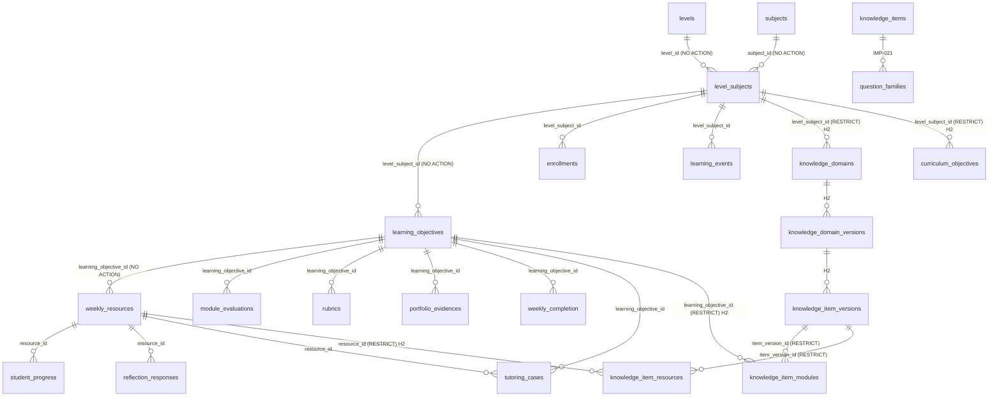

# Mapa de relaciones del subsistema de recursos

Fuente: `evidencia/inventario_esquema.txt` (esquema real, `PRAGMA foreign_key_list`). Las flechas son claves foráneas; entre paréntesis, la acción al borrar.

## Cómo se lee

1. **Cadena curricular real de la aplicación** (heredada): `levels` y `subjects` → `level_subjects` → `learning_objectives` (módulos) → `weekly_resources`. La **asignatura de un recurso no está en su fila**: es `weekly_resources.learning_objective_id → learning_objectives.level_subject_id`.
2. **Capa lateral de H2:** `knowledge_domains` también tiene `level_subject_id`. Dos vínculos la unen a la cadena heredada: `knowledge_item_modules → learning_objectives` y `knowledge_item_resources → weekly_resources`. La regla «el módulo o recurso vinculado es de la misma asignatura que el dominio» compara la asignatura del dominio con la derivada de la cadena heredada, **solo al crear el vínculo y al validar y publicar**.
3. **Por qué importa:** dos caminos llegan a la misma asignatura (el dominio y el módulo del recurso) y **nada obliga a que coincidan después**. Cambiar `learning_objective_id` de un recurso, o `level_subject_id` de un módulo, rompe esa igualdad sin tocar ninguna tabla de H2.
4. **Doble referencia sin restricción:** `tutoring_cases` guarda `learning_objective_id` y `resource_id` por separado; ninguna restricción exige que el recurso pertenezca al objetivo.

## Dependencias por tipo de cambio

| Cambio | Tablas que lo ven | Quién lo detiene hoy |
|---|---|---|
| `weekly_resources.id` | `student_progress`, `reflection_responses`, `tutoring_cases`, `knowledge_item_resources` | Clave foránea, solo si hay hijos |
| `weekly_resources.learning_objective_id` | los cuatro anteriores (por derivación) y la regla de asignatura de H2 | **Nadie** |
| `learning_objectives.level_subject_id` | `weekly_resources` (derivado), `knowledge_item_modules`, `knowledge_item_resources` | **Nadie** |
| Borrar un recurso o un módulo | los dependientes | Clave foránea (`NO ACTION` o `RESTRICT`) |

## Triggers y restricciones en la cadena heredada

**Ninguno**: ni triggers ni `CHECK` ni claves únicas compuestas. Las únicas defensas son la clave primaria, las claves foráneas y los índices.
