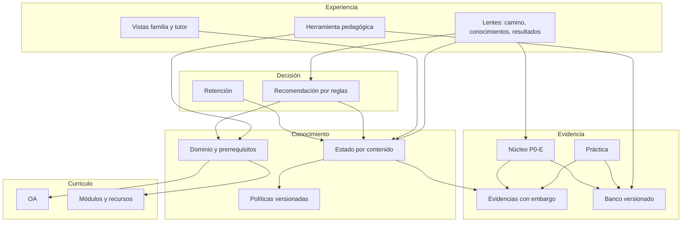

# 01. Arquitectura general

**Estado:** PROPUESTO, salvo lo marcado. Reglas: ver `docs/p0e/README.md`.

## 1. Inventario real

Verificado por lectura en `vortice/integracion`. «Existe» no implica que funcione en producción: producción tiene solo la landing (rama `landing/asi-trabajamos`) y no tiene login configurado.

| Componente | Estado | Evidencia y brecha |
|---|---|---|
| Niveles, asignaturas, matrícula | EXISTE EN CÓDIGO | `levels`, `level_subjects`, `enrollments` |
| Módulos y recursos | EXISTE EN CÓDIGO | `learning_objectives` (módulo), `weekly_resources` |
| Avance de lecciones | EXISTE EN CÓDIGO | `student_progress` |
| Cálculo de acceso a módulo | EXISTE, a cambiar | `checkModuleAccess`: exige `passed` en `evaluation_number = 2` |
| Corrección en servidor | EXISTE | `POST /api/evaluations/:id/submit`; responde solo resultado |
| Intentos, ventanas, cierres, `review_at`, versiones, lotes | NO EXISTE | `evaluation_progress` es una fila por envío, sin límite. `passingScore ?? 60` |
| Pregunta con id de contenido | NO EXISTE | `questions_json`: `id`, enunciado, opciones por índice, clave por **posición** |
| Generación de preguntas | EXISTE, sin revisión | `aiEvaluationGenerator.ts` |
| Repaso espaciado | PARCIAL | `server/repaso.ts`, con preguntas de evaluación, programación neutra |
| Eventos de aprendizaje | EXISTE | `learning_events`; no es evidencia |
| Familia | EXISTE, solo estado | `server/familia.ts` |
| Tutoría | EXISTE | `tutoring_cases` |
| Portafolio, Brújula, notificaciones | EXISTE | Fuera de alcance salvo DTO |
| Copiloto | EXISTE, sin validar; **fuera del piloto** | [07](07_COPILOTO_IA.md) |
| Contenidos, prerrequisitos, estado, fronteras, mapa, motor, banco práctica | NO EXISTE | Este diseño |
| Diagnóstico con selección dinámica, modelos estadísticos | NO EXISTE | Fuera de la versión 1 |

## 2. Capas

**Reglas de dependencia:**
1. La evidencia alimenta al estado; el estado **nunca** cambia resultados de P0-E.
2. El acceso a módulo y evaluación lo decide P0-E y calendario; la recomendación solo orienta.
3. Toda lectura de evidencia pasa por el filtro de publicación ([08](08_SEGURIDAD_Y_GOBIERNO.md) §7.3).
4. Solo cuatro indicadores: `PROGRESO` §5.4, cada uno con su fuente.

## 2.1 Cinco conceptos que no se confunden

| Concepto | Vista | Fuente única | Lo cambia | No puede |
|---|---|---|---|---|
| Avance de lecciones | Mi camino | `student_progress` | Completar recurso | Marcar dominio ni aprobar |
| Dominio de contenidos | Mis conocimientos | `student_knowledge_state`, desde evidencia | Evidencia liberada | Cambiar resultado ni acceso |
| Resultados | Mis resultados | Núcleo P0-E (hoy `evaluation_progress`) | Envío de intento | Marcar dominio por sí solo |
| Recomendación | Mi camino y Mis conocimientos | `recommendation_log` | Motor por reglas | **Abrir, cerrar o bloquear nada** |
| Continuidad de módulos | Mi camino | `checkModuleAccess`, P0-E y calendario; `progression_continuations` si se ratifica D2 | Reglas P0-E | Depender del mapa o de una recomendación |

Las vistas se conectan **solo con enlaces**: un resultado enlaza a contenidos por reforzar; un contenido enlaza a su lección. Ningún indicador se calcula sumando otro. No existe un «progreso total» que los combine.

## 3. Módulos de código (propuesta)

Sigue el patrón actual: lógica pura en `shared/`, datos en `server/`, prueba en `script/*.check.ts`.

| Archivo futuro | Responsabilidad |
|---|---|
| `shared/dominio.ts` | `evaluar`, fronteras, siguiente. Puro |
| `server/conocimiento.ts` | Repositorio: lecturas con filtro único y transacciones de evidencia |
| `server/practica.ts` | Sesiones, entrega, corrección |
| `server/catalogo.ts` | Flujo editorial, publicación, validación del grafo |
| `client/src/pages/vortice/...` | Lentes |

**Rendimiento:** dominio pequeño en piloto; se calcula por contenido al escribir. Sin caché ni colas hasta medir. `db.batch` para atomicidad (T1 local OK).

## 4. Índice

[00 Resumen](00_RESUMEN_EJECUTIVO.md) · [02 Modelo](02_MODELO_DE_CONOCIMIENTO.md) · [03 Evidencias](03_MOTOR_DE_EVIDENCIAS.md) · [04 Datos](04_MODELO_DE_DATOS.md) · [05 Algoritmos](05_ALGORITMOS_Y_RECOMENDACIONES.md) · [06 Experiencia](06_EXPERIENCIA_DEL_ESTUDIANTE.md) · [07 Copiloto](07_COPILOTO_IA.md) · [08 Seguridad](08_SEGURIDAD_Y_GOBIERNO.md) · [09 Plan](09_PLAN_DE_IMPLEMENTACION.md) · [10 Decisiones](10_DECISIONES_PENDIENTES.md)
