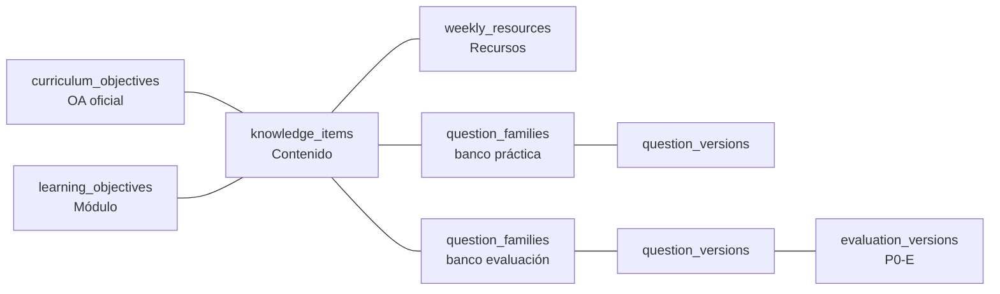
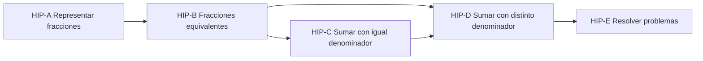

# 02. Modelo de conocimiento

**Estado:** PROPUESTO. Base: K1–K14 (COMUNICADO). Nada de esto EXISTE EN CÓDIGO. Datos: [04](04_MODELO_DE_DATOS.md). Cálculo: [05](05_ALGORITMOS_Y_RECOMENDACIONES.md).

## 1. Conceptos y su representación

| Concepto KST | En Vórtice | Tabla propuesta |
|---|---|---|
| Dominio Q | Conjunto de contenidos de una unidad o asignatura y nivel, en una versión | `knowledge_domains`, `knowledge_domain_versions` |
| Ítem | **Contenido**: unidad pequeña, observable, enseñable y evaluable | `knowledge_items`, `knowledge_item_versions` |
| Estructura (Q, K) | Grafo de prerrequisitos, del que se derivan los estados factibles | `knowledge_prerequisites` |
| Estado K | Contenidos en `dominado` para un estudiante | `student_knowledge_state` |
| Fronteras | Se calculan; nunca se guardan como verdad | Ver [05](05_ALGORITMOS_Y_RECOMENDACIONES.md) |

**Límite honesto.** La etapa 1 usa solo relaciones de precedencia. Eso representa un subconjunto de los espacios de KST (cada estado es un conjunto cerrado bajo prerrequisitos). No es el modelo de ALEKS, cuyo algoritmo es propietario y no se copia.

## 2. Contenido: identidad y almacenamiento

- **Identidad estable:** `knowledge_items.id` (UUID) y `code` legible y único por dominio. El nombre puede cambiar; el id no.
- **Definición versionada:** cada cambio de nombre, definición operacional o criterio crea fila en `knowledge_item_versions`. Lo publicado no se edita.
- **Publicación por dominio completo:** se publica una `knowledge_domain_version` con sus contenidos y aristas. Así un grafo nunca queda a medias. Ciclo: `borrador → en_revision → validada → publicada → retirada`.
- **Validación (K5, K7):** `validada` exige revisor humano registrado, distinto del autor (PROPUESTO). Quién: O4.

Prueba de calidad de una definición (PROPUESTO): completa la frase «el estudiante puede… en una tarea donde…». Si no se puede escribir una pregunta que la mida, el contenido está mal definido.

## 3. Vínculos

**Hallazgo.** EXISTE EN CÓDIGO: `learning_objectives` representa un **módulo** (`week_number`), con `code` y `module_oas` en texto. No es un catálogo normalizado de OA. Por eso se propone `curriculum_objectives`, cargada desde fuente oficial y verificada por una persona, y un vínculo aparte al módulo.

| Vínculo | Cardinalidad | Regla |
|---|---|---|
| Contenido ↔ OA | N:M | Todo contenido publicado tiene al menos un OA. El motor nunca redefine OA |
| Contenido ↔ módulo | N:M | Permite saber qué contenidos cubre cada módulo y mostrar refuerzo |
| Contenido ↔ recurso | N:M, con rol (`explicacion`, `ejemplo`, `repaso`) | Reutiliza `weekly_resources` |
| Pregunta ↔ contenido | N:1 principal en etapa 1 | Una pregunta aporta evidencia a un solo contenido. Varias habilidades a la vez: dividir la pregunta. Alternativa multi-contenido: etapa posterior |
| Actividad ↔ contenido | Vía pregunta o recurso | Abrir un recurso **no** es evidencia de dominio (informe 5.1) |

## 4. Prerrequisitos

Cada arista guarda: contenido, prerrequisito, tipo, justificación, nivel de confianza, validador y fecha, dentro de una versión del dominio.

| Tipo | Efecto | Etapa |
|---|---|---|
| `necesaria` | Bloquea la frontera externa | 1 |
| `contributiva` | Orienta el orden; no bloquea | 1 |
| `alternativa` | Se cumple con cualquiera del grupo `alt_group` | 2 (K8) |

**Validación técnica al publicar:** sin ciclos (orden topológico); sin referencias a contenidos fuera de la versión; sin contenidos inalcanzables; sin aristas sin validador. La validación pedagógica es humana. Ninguna arista se crea por correlación.

**Rutas alternativas (etapa 2).** Sin cambiar tablas: la regla de disponibilidad pasa de «todos los necesarios» a «todos los necesarios y, por cada `alt_group`, al menos uno». Solo cambia una versión de política del motor. En etapa 1 una restricción impide publicar `alternativa`.

## 5. Estado de dominio

| Estado | Clasificación | Regla |
|---|---|---|
| `sin_evidencia` | PROPUESTO | Sin evidencia liberada |
| `dominado` | COMUNICADO (K6) | Al menos 2 correctas en **familias** distintas, con evidencia válida. Detalles abiertos: O2, O3, N2, N9 |
| `no_dominado` | PREGUNTA ABIERTA (O1) | Recomendación en [03](03_MOTOR_DE_EVIDENCIAS.md) §7 |
| `incierto` | PROPUESTO, requiere aprobación (O6) | Hay evidencia, pero no alcanza ninguna de las anteriores |

Marca aparte de `dominado`: `por_comprobar`, si hay un error posterior o retención vencida ([03](03_MOTOR_DE_EVIDENCIAS.md) §6). Si O6 rechaza `incierto`, la implementación lo presenta como `por aprender` sin cambiar los datos.

**Actualización.** El estado no se escribe a mano: `evaluar(evidencias liberadas, política)` lo deriva. Cada cambio agrega una fila a `knowledge_state_events`, y `student_knowledge_state` es una proyección reconstruible. Una corrección docente es una evidencia nueva de tipo `revision_docente`, no una edición. Autorización de esa vía: pendiente.

**Historial.** `knowledge_evidence` y `knowledge_state_events` son solo de inserción. Cada estado guarda la versión de dominio y de política con que se calculó.

## 6. Retención

- **Dominio inicial ≠ retención.** `dominado_en` y `ultima_comprobacion_en` se guardan aparte.
- **Medida (PROPUESTA):** tasa de acierto en la primera comprobación tras cada intervalo, por contenido y por política. Sin meta aprobada.
- **Agenda:** `retention_schedule` por estudiante y contenido. Intervalos configurables. EXISTE EN CÓDIGO una base técnica reutilizable (`INTERVALS` = 1, 3, 7, 16 días en `shared/repaso.ts`), pero su uso pedagógico para retención **no** está validado: O8.
- **Banco:** solo familias de práctica, distintas a las que dieron el dominio cuando sea posible.

## 7. Ejemplo completo: Matemática de 5.º Básico

> **TODO ES HIPOTÉTICO.** Contenidos, relaciones y respuestas son ilustrativos. No están validados, no provienen de una unidad definida (O5) y no se vinculan a un OA real. No usar como catálogo.

Política hipotética: recomendaciones de [03](03_MOTOR_DE_EVIDENCIAS.md) (solo sin ayuda; 2 errores en familias distintas = `no_dominado`).

| Día | Fuente | Contenido | Familia | Correcta | Ayuda | Efecto |
|---|---|---|---|---|---|---|
| 1 | Práctica | A | F-A1 | Sí | No | A `incierto` |
| 1 | Práctica | A | F-A2 | Sí | No | A `dominado` (K6) |
| 2 | Práctica | B | F-B1 | Sí | Pista | Registrada; no cuenta para K6 |
| 2 | Práctica | B | F-B1v2 | Sí | No | Misma familia: B `incierto`, 1 familia |
| 3 | Práctica | B | F-B2 | Sí | No | B `dominado` |
| 4 | E2, intento 1 | C | F-EC1 | No | No | **Embargada** hasta `review_at`: el mapa no cambia |
| 4 | Práctica | C | F-C1 | Sí | No | C `incierto` |
| 8 | Retención | A | F-A3 | No | No | A sigue `dominado`, marca `por_comprobar` |
| 9 | `review_at` llega | C | F-EC1 | No | No | Se libera: C `incierto`, 1 correcta y 1 error |

**Situación al día 9.** K = {A, B}. Frontera externa = {C} (D exige C). Frontera interna = {B} (reciente, sin sucesor dominado). Recomendación: comprobar A; luego C. D y E, `bloqueado`.

Sus resultados de E2 (porcentaje y estado) van por otro canal: ver [03](03_MOTOR_DE_EVIDENCIAS.md) §8.
