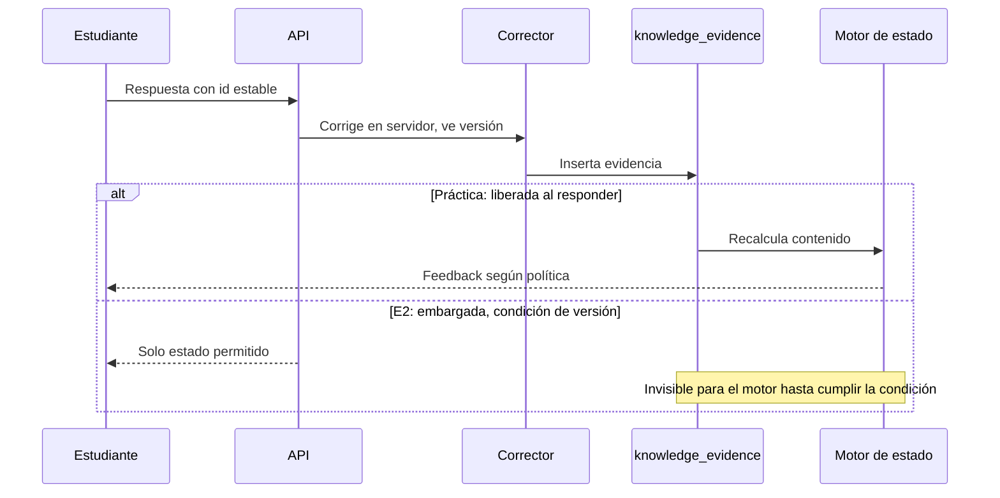
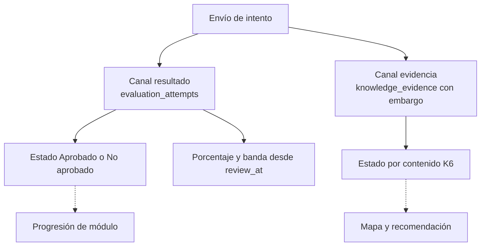
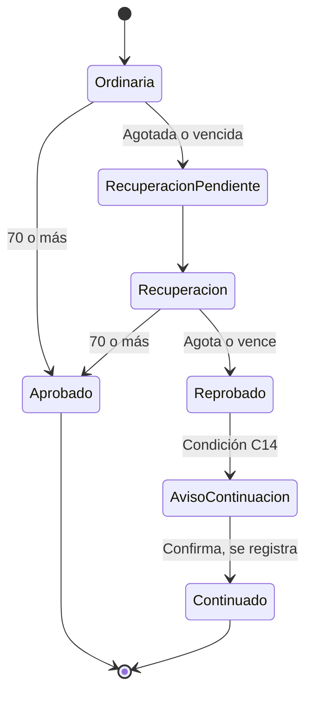

# 03. Motor de evidencias y relación con P0-E

**Estado:** PROPUESTO. Donde hay decisión pedagógica: alternativas y recomendación, sin imponerla. Reglas P0-E: especificación maestra, no se modifican.

## 1. Qué es evidencia

Una **evidencia** es una respuesta corregida en el servidor, a una pregunta versionada y aprobada, asociada a un contenido.

| Fuente | ¿Evidencia? | Publicación |
|---|---|---|
| Práctica de banco separado | Sí | Inmediata |
| Comprobación de retención | Sí | Inmediata |
| E1, E3, E4 | Sujeto a C6, N4, P16 | Ver §8 |
| E2 ordinaria y recuperación | Sujeto a N2 | Embargada hasta cumplir la condición de §8.3 |
| Formularios externos | **No** (sin respuesta por pregunta; P8) | No aplica |
| Copiloto | **No** | No aplica |
| Video o lectura abiertos, tiempo | **No**: exposición, no dominio | No aplica |
| Registros antiguos `evaluation_progress` | **No** por omisión (N6) | No aplica |
| Reflexiones y portafolio | No en etapa 1; requieren rúbrica | No aplica |

**Flujo:**



## 2. Asociación respuesta → contenido

La respuesta apunta a `question_version_id`; esta, a su familia; la familia, a un contenido. La evidencia copia esos identificadores al insertarse (fotografía), para que una edición futura no cambie el pasado. Una pregunta sin contenido aprobado no se puede publicar (K4).

## 3. Práctica frente a evaluación

| | Práctica | Evaluación P0-E |
|---|---|---|
| Propósito | Aprender | Certificar |
| Intentos | Sin límite P0-E (ritmo: política) | 2/3/2/2 y recuperación con 2 |
| Feedback | Inmediato por contenido | Solo estado, hasta `review_at` |
| Banco | `bank = practica` | `bank = evaluacion` |
| Registro | `practice_attempts` | `evaluation_attempts` |

**Separación de bancos, garantizada en base de datos.** Cada familia pertenece a un banco para siempre. Una clave foránea compuesta `(family_id, bank)` con `CHECK (bank = 'practica')` impide que la práctica use una pregunta de evaluación, y viceversa. Ver [04](04_MODELO_DE_DATOS.md). Una versión de evaluación retirada no pasa a práctica. Esto reemplaza la dependencia provisional de `server/repaso.ts` (C11).

## 4. Preguntas generadas con IA (K13)

- EXISTE EN CÓDIGO: `aiEvaluationGenerator.ts` guarda preguntas en `questions_json` sin revisión humana previa ni contenido.
- PROPUESTO: flujo `borrador → en_revision → aprobada → retirada`. `aprobada` exige `reviewed_by` humano, por `CHECK`. Se guarda el origen: `humano` o `ia`, modelo y huella del prompt.
- Solo `aprobada` se entrega. Editar una aprobada crea versión nueva.
- La IA nunca marca revisión, crea aristas ni define contenidos publicados.
- Las preguntas existentes en `questions_json` no se importan solas: pasan por el mismo flujo.

## 5. Preguntas casi iguales (N9)

**Mecanismo:** la familia es la unidad de independencia. K6 cuenta **familias** distintas, no preguntas. Cambiar los números de una misma plantilla es otra versión o variante de la misma familia.

| Alternativa | Consecuencia |
|---|---|
| **A. Familia asignada por revisor humano, con detector de apoyo (recomendada)** | Criterio pedagógico explícito. Requiere trabajo editorial |
| B. Detector automático de similitud decide | Barato; se equivoca con preguntas cortas |
| C. Toda pregunta distinta cuenta | Infla el dominio |

Detector (determinista, solo aviso): normaliza texto, reemplaza números por marcador y compara palabras. Reutiliza la idea de `matchesEvaluationQuestion` de `shared/iaPolicy.ts`.

## 6. Respuesta asistida y error posterior

**Ayuda (O3).** Campo `assistance`: `ninguna`, `pista`, `explicacion_vista`, `tutor`. Solo registra ayuda ofrecida **por la práctica**. Ajuste de accesibilidad va aparte: `accommodation` (O9). **No se confunde apoyo de accesibilidad con ayuda.**

| Alternativa | Consecuencia |
|---|---|
| **A. Solo cuenta para K6 lo que no tuvo ayuda; lo demás se guarda (recomendada)** | Protege «autónomo». Más práctica |
| B. Cuenta con peso menor | Requiere pesos sin evidencia |
| C. Todo cuenta | Dominio inflado |

**Límite:** el servidor no ve ayuda externa (familia, otra pestaña, **ni el copiloto**, que queda desconectado del piloto: C19). `assistance = ninguna` significa «sin ayuda registrada», no «sin ayuda». K6 es evidencia, no certeza.

**Error posterior al dominio.** La evidencia se inserta; no se borra nada.

| Alternativa | Consecuencia |
|---|---|
| **A. Sigue `dominado` con `por_comprobar` y comprobación próxima; con 2 errores en familias distintas sin acierto posterior, pasa a `incierto` (recomendada)** | Tolera descuido, reacciona a patrón |
| B. Un error lo baja a `incierto` | Sensible a ruido; desmotiva |
| C. Dominio permanente | Ignora retención |

## 7. Estado «no dominado» e incertidumbre

**O1.**

| Alternativa | Regla |
|---|---|
| **A (recomendada)** | Errores en al menos 2 familias distintas y menos de 2 correctas válidas |
| B | Solo si falla también el prerrequisito inmediato |
| C | No existe; todo es «por aprender» |

**Incertidumbre, versión 1 (determinista).** No hay probabilidad ni porcentaje. Se guardan hechos y un motivo:

| Campo | Ejemplo |
|---|---|
| `correct_families`, `wrong_families`, `assisted_count` | conteos |
| `last_evidence_at`, `last_retention_ok_at` | fechas |
| `uncertainty_reason` | `pocas_evidencias`, `contradictoria`, `solo_con_ayuda`, `retencion_vencida`, `banco_insuficiente` |

Al estudiante no se le muestra probabilidad (O6). Una probabilidad real exige datos y calibración: [05](05_ALGORITMOS_Y_RECOMENDACIONES.md) §6.

## 8. Convivencia con P0-E

**Principio.** Dos canales independientes: el **resultado** de la evaluación (P0-E) y el **estado** por contenido. Ninguno se calcula desde el otro.



### 8.1 K6 y 70 % (N1)

| Situación posible | Evaluación | Contenido |
|---|---|---|
| Aprueba E2, falla 2 preguntas de C | Aprobada | C sin cambio o con errores |
| No aprueba E2, pero domina en práctica | No aprobada | `dominado` |
| Aprueba E2 con 1 pregunta por contenido | Aprobada | 1 sola familia: K6 no se cumple |

| Alternativa | Consecuencia |
|---|---|
| **A. Independientes; E2 solo aporta evidencia por pregunta (recomendada)** | No cambia reglas aprobadas. Puede haber casos que requieren explicación |
| B. Aprobar E2 marca todo el módulo `dominado` | Contradice K6 |
| C. Exigir dominio para aprobar o rendir E2 | Cambia P0-E; requiere decisión expresa |

### 8.2 E1 a E4

| Evaluación | Regla aprobada | Conflicto | Diseño |
|---|---|---|---|
| E1, E3, E4 | 2 intentos, estado inmediato, pauta diferida | K11 pide feedback inmediato: C6. P16 sin aprobar | `evaluation_function` y `release_policy` como datos (nulos hasta P16) |
| E2 | 3 intentos, recuperación con 2 | P21, C3 | Evidencia embargada |

**Alternativas C6 / N4:**

| Alternativa | Cumple K11 | Cumple regla aprobada |
|---|---|---|
| **A. Feedback inmediato en banco de práctica separado; E1, E3, E4 conservan estado hasta `review_at` (recomendada)** | Parcial: mismo fin, otro lugar | Sí |
| B. Feedback por contenido inmediato en E1, E3, E4 | Sí | No: requiere enmendar la maestra y aceptar riesgo, sobre todo si otros siguen respondiendo la versión |
| C. Como B, solo al cerrar la instancia del estudiante | Parcial | No sin enmienda: la ventana sigue abierta para otros |

### 8.3 Embargo: que el mapa no revele E2

**Corrección tras auditoría.** La versión anterior fijaba la liberación en `review_at` de la instancia. **Era insuficiente:** la especificación maestra §3 (APROBADO, P19) exige además que la instancia esté cerrada y que **ningún otro estudiante pueda seguir respondiendo esa misma versión**.

**Dos cierres distintos:**

| | Cierre de instancia | Cierre de versión compartida |
|---|---|---|
| Alcance | Un estudiante | Todos los asignados a esa versión |
| Ocurre | Aprueba, agota o vence | Nadie puede responderla ya |
| Efecto en él | No más intentos; solo estado | Habilita, junto a lo demás, la publicación |
| Libera información | **No, por sí solo** | Solo con la condición completa |

**Condición de publicación (la más restrictiva):**

```text
publicable(instancia, ahora) =
     instancia cerrada
  y  ahora >= instancia.review_at
  y  versión(instancia) cerrada para todos   # N20
```

Aplica por igual a pauta, respuestas correctas, explicaciones, porcentaje, banda, contenidos no logrados y evidencia por contenido. Fecha efectiva: la mayor entre `review_at` y `evaluation_version_releases.released_at`.

**Quién determina que una versión ya no puede responderse: NO ESTÁ DEFINIDO (N20).** La maestra lo define para lotes de recuperación (§4: ventana terminada, instancias cerradas, sin intentos activos), pero no da un mecanismo para versiones ordinarias.

| Alternativa | Funcionamiento | Consecuencia |
|---|---|---|
| A. Derivada | El sistema comprueba que toda instancia de la versión esté cerrada, sin intentos activos, y registra la liberación | Automática. Sensible a matrícula tardía (N21) |
| B. Acto humano | Una persona autorizada declara el cierre, con verificación | Controlada. Puede atrasar resultados |
| C. Derivada más confirmación | A propone; una persona confirma | Más segura; más carga |

Sin recomendación cerrada: depende de la operación de matrículas, no verificada. **Mientras no se decida, nada se publica por esta vía.**

**Invariantes técnicas (PROPUESTO):**
1. La liberación es de una sola vía: no se deshace.
2. No se asigna una versión ya liberada a una instancia nueva (P18: nadie responde una versión con pauta publicada).
3. Si una versión queda abierta por una instancia sin cerrar, **todos** esperan.

**Estudiante que aprueba mientras otros responden:** ve «Aprobado» (regla aprobada) y su instancia cierra. Nada más: sin porcentaje, pauta, cambio en el mapa ni contenidos fallados, aunque su propio `review_at` ya haya pasado. No puede reabrir ni acelerar la liberación de nadie.

**Límite:** el sistema no evita que un estudiante cuente de memoria las preguntas a otro.

**Canales derivados.** Estado de conocimiento, mapa, recomendaciones, notificaciones, vistas de familia y tutoría, exportaciones, repaso y copiloto usan solo evidencia publicable, por el filtro único ([08](08_SEGURIDAD_Y_GOBIERNO.md) §7). Pruebas NI4 y NI5, misma sección.

| Alternativa N2 | Consecuencia |
|---|---|
| **A. E2 es evidencia, embargada (recomendada)** | Aprovecha datos; cumple C7 |
| B. E2 nunca es evidencia | Más simple y seguro; desperdicia datos; K6 depende solo de práctica |
| C. E2 actualiza de inmediato | **No viable**: filtra la pauta |

**Prueba de no interferencia (obligatoria):** protocolo, filtro único, cálculo en `review_at` y fallos: [08](08_SEGURIDAD_Y_GOBIERNO.md) §7.

**Sobre el estudiante con E2 embargada:** si practica mientras, el mapa avanza solo con práctica. No se bloquea el contenido por E2 abierta. P10 sigue pendiente para el repaso de preguntas evaluativas, que aquí no se usa.

### 8.4 Publicación tras `review_at`

Sujeto a D1–D4 y a la condición de §8.3: porcentaje real del intento que cuenta (Q: mejor o último, sin definir; la maestra no lo fija: N14), banda y contenidos a reforzar. La pauta sigue P19, de solo lectura. Durante el proceso solo estado. `review_at` por sí solo no publica.

### 8.5 Contenidos a reforzar (C8)

| Alternativa | Regla |
|---|---|
| **A. Contenidos del módulo no `dominado` con al menos un error liberado (recomendada)** | Una sola fuente: el estado. Evita dos criterios |
| B. Menos de 70 % por contenido en el intento (propuesta previa en `PROGRESO` §4) | Necesita varias preguntas por contenido (N5, Q4) |
| C. Ambos, mostrados por separado | Confuso |

Sin contenidos etiquetados (fuera del piloto), solo se muestra el nivel módulo; no se inventa detalle.

### 8.6 P21 (COMUNICADO, requiere D2 y C15)



- `progression_continuations`: una fila por proceso. Guarda fotografía de contenidos pendientes, recursos ofrecidos y confirmación. El resultado no cambia.
- **No** marca dominados, no reescribe nada. El módulo abierto muestra los contenidos sin base como `requiere base`, y se pueden abrir (C9, alternativa recomendada en [10](10_DECISIONES_PENDIENTES.md)).
- **C14:** recomendado: continuar solo cuando la condición de §8.3 se cumpla para la recuperación. Esto puede alargar la espera (C23).
- Depende del núcleo P0-E. Fuera de piloto la lista es de módulo.

## 9. K6: comportamiento por escenario

**K6 es un criterio operativo de evidencia suficiente, no una certeza de aprendizaje.** «Dominado» significa: el sistema reunió la evidencia acordada. Puede haber azar, ayuda externa u olvido posterior.

**Tipos de regla.** **[T]** técnica: consecuencia del diseño de datos. **[P]** pedagógica: recomendación que la dirección debe aprobar; hasta entonces el parámetro está nulo en `mastery_policies`. Solo K6 (2 correctas, familias distintas) es COMUNICADO.

Supuesto de la tabla: alternativas recomendadas. Todo es evidencia liberada, y sin ayuda salvo que se diga.

| # | Escenario | Evidencia registrada | ¿Cuenta para K6? | Estado | `por_comprobar` | Historial | Revisión humana |
|---|---|---|---|---|---|---|---|
| 1 | 2 correctas, familias distintas | 2 filas | Sí **[K6]** | `dominado` | No | 2 evidencias, 1 evento | No |
| 2 | 2 correctas, misma familia | 2 filas | Solo 1 familia **[T]** | `incierto`, `pocas_evidencias` | No | Se conservan | No; si el banco no tiene otra familia, alerta |
| 3 | Incorrecta, luego correcta, misma familia | 2 filas | Correcta sí, 1 familia. El error deja de contar como `errada` **[P]** | `incierto` | No | Se conservan | No |
| 4 | 2 correctas (distintas), luego incorrecta | 3 filas | Las 2 siguen contando **[P]** | `dominado` | Sí | Evento solo de marca | No; 2 errores en familias distintas sin acierto: `incierto` **[P]** |
| 5 | Correcta con ayuda | 1 fila con `assistance` | No **[P, O3]** | Sin cambio de K6; `solo_con_ayuda` si es todo lo que hay | No | Se conserva | No |
| 6 | Incorrecta con ayuda | 1 fila | No cuenta para K6 ni como errada para O1 **[P, N16]** | Sin cambio | No | Se conserva | No; patrón repetido: aviso al tutor, D4 |
| 7 | Pregunta anulada por defecto | Sin borrar; `question_voids` y `evidence_voids` | No **[T]** | Se recalcula: puede dejar de ser `dominado` | Sí si baja | Evento `anulacion` | **Sí**: solicitante y aprobador distintos |
| 8 | Pregunta retirada, sin defecto | Sin cambios | Sí: retirar no invalida **[P, N17]** | Sin cambio | No | Se conserva; no se sirve más | Sí al retirar |
| 9 | Nueva versión del contenido | Sin cambios; cita su versión | Según `evidence_continuity` **[P, N18]** | `compatible`: sin cambio. `ruptura`: se recalcula | Con `ruptura`: sí | Evento `nueva_version` | **Sí**, por contenido |
| 10 | Retención fallida tras dominio | 1 fila `retencion` | Las 2 originales siguen **[P, O8]** | `dominado` | Sí; agenda vuelve al primer paso | Evento de marca | No; 2 fallas distintas: `incierto` y aviso |

### Alternativas para lo no decidido

**Escenarios 4 y 10 (dominio tras error).** Ver §6. Consecuencia de la recomendada: un estudiante puede verse `dominado` con errores recientes; por eso la marca es visible y se comprueba. Alternativa B (un error baja el estado): más prudente, más ruido y más desmotivación. Alternativa C: dominio permanente, descartada porque ignora retención.

**Escenario 3 (error reparado).** A (recomendada): solo cuenta como errada una familia sin acierto posterior; refleja aprendizaje. B: todo error cuenta para siempre; más estricto, y puede impedir salir de `no_dominado`.

**Escenario 6, N16.** A (recomendada): no cuenta como errada, porque la ayuda altera las condiciones. B: cuenta; un error incluso con ayuda es señal fuerte. Consecuencia de A: se pierde esa señal para el estado, pero se conserva para el tutor.

**Escenario 7.** Técnica: la anulación es por inserción. Decisión pendiente: ¿quién aprueba? (O4), ¿se avisa al estudiante cuyo estado baja? Recomendación: sí, sin culpar («revisamos esta pregunta»).

**Escenario 8, N17.** A (recomendada): sigue contando si se retiró por renovación. B: deja de contar. Si hubo defecto, es el escenario 7. Motivo de retiro obligatorio.

**Escenario 9, N18.** A (recomendada): una persona declara `compatible` o `ruptura` por contenido; `ruptura` mueve a `por_comprobar` en vez de borrar el dominio de golpe. B: toda versión reinicia. Simple e injusto ante correcciones menores. C: nunca reinicia; el dominio puede referirse a algo ya distinto.

### 9.1 Sesión e identidad temporal

**Técnico (PROPUESTO):**

| Tema | Definición |
|---|---|
| Sesión de práctica | Fila de `practice_sessions`, **creada por el servidor** al empezar. Un periodo de trabajo con un fin (`practica` o `retencion`) |
| Identificador | `practice_sessions.id`, UUID del servidor. Nunca lo elige el cliente |
| Sesión en evaluación | El intento: `evaluation_attempts.id` |
| Fin de sesión | Cierre explícito, apertura de otra, o caducidad técnica para no dejar filas huérfanas |
| Caducidad técnica | Solo limpieza. **No tiene significado pedagógico**: no define si dos respuestas son independientes |
| Una activa | Un estudiante, una sesión abierta por dominio |
| Secuencia | `session_ref` y `sequence_no` (contador del servidor, por estudiante), más `occurred_at`. Orden: (`occurred_at`, `sequence_no`). El reloj del cliente no se usa |
| Día | `study_day`, fecha en hora de Chile, calculable con `dayKey` (EXISTE en `shared/repaso.ts`) |

La evidencia embargada entra en su orden real al liberarse (`occurred_at`), con evento `effective_at` en la liberación. Lo ocurrido antes no se reescribe.

**Requiere decisión académica (O2): ¿cuándo son «sesiones distintas» para K6?**

| Alternativa | `k6_separation` | Consecuencia |
|---|---|---|
| A. Sin separación | `ninguna` | Dos aciertos seguidos bastan. Mide poco la estabilidad |
| B. Sesión distinta | `sesion` | Se evade cerrando y abriendo. No exige tiempo |
| C. Día calendario distinto | `dia` | Sin umbral en minutos, explicable. Atrasa el dominio al menos un día |
| D. Intervalo mínimo | `intervalo:<n>` | **El valor sería una decisión pedagógica**, sin evidencia hoy. El sistema no propone número |

**Recomendación técnica:** C, o A si se busca sencillez en el piloto. **O2 sigue abierta**: `k6_separation` queda nulo, y una política con nulos no se ejecuta. Se corrige la recomendación anterior («sesiones distintas»), porque B se puede eludir. **No se usa un tiempo de espera como sustituto de esta decisión.**

**Corrección docente (N19).** Tres casos que no se confunden:

| Caso | Tratamiento |
|---|---|
| Pregunta defectuosa | Anulación ([04](04_MODELO_DE_DATOS.md) §8). Técnico; revisión humana |
| Docente cree que un estado es erróneo | **No hay vía en la primera versión.** Se registra una solicitud fuera del motor (N19) |
| Corrección de resultado de evaluación | No pasa por aquí (N12) |

### 9.2 Pruebas de K6

Sin ejecutar. Solo en memoria. `2F` = dos familias distintas. Cada una se corre con cada alternativa de política aún abierta.

| ID | Secuencia | Esperado |
|---|---|---|
| TK1 | Error F1, luego acierto F1 | `incierto`; error reparado no cuenta como errada (alternativa recomendada) |
| TK2 | Acierto F1, acierto F2, error F3 | `dominado`, `por_comprobar` |
| TK3 | Acierto F1 sesión S1, acierto F2 sesión S2, mismo día | `dominado` con `ninguna` y `sesion`; `incierto` con `dia` |
| TK4 | Igual que TK3, misma sesión | `dominado` solo con `ninguna` |
| TK5 | Igual que TK3, días distintos | `dominado` con `ninguna`, `sesion`, `dia` |
| TK6 | 2F, una con ayuda | `incierto` si ayuda no cuenta; ayuda registrada |
| TK7 | 2F con ayuda, error con ayuda | Sin cambio por el error (alternativa N16 A) |
| TK8 | 2F, se anula F1 | Baja a `incierto`; evento `anulacion`; evidencias intactas |
| TK9 | 2F, se retira F1 sin defecto | `dominado`; F1 no se sirve más |
| TK10 | 2F, versión `compatible` | Sin cambio |
| TK11 | 2F, versión `ruptura` | `por_comprobar`, evento `nueva_version` |
| TK12 | Corrección docente de estado | Rechazada: sin vía; el estado no cambia |
| TK13 | Mismo envío repetido | Una respuesta y una evidencia (`client_submission_id`) |
| TK14 | Acierto F1 en E2 embargado, acierto F2 práctica | `incierto` hasta publicar; luego `dominado`, con orden real |
| TK15 | `k6_separation` nulo | La política no se ejecuta |
