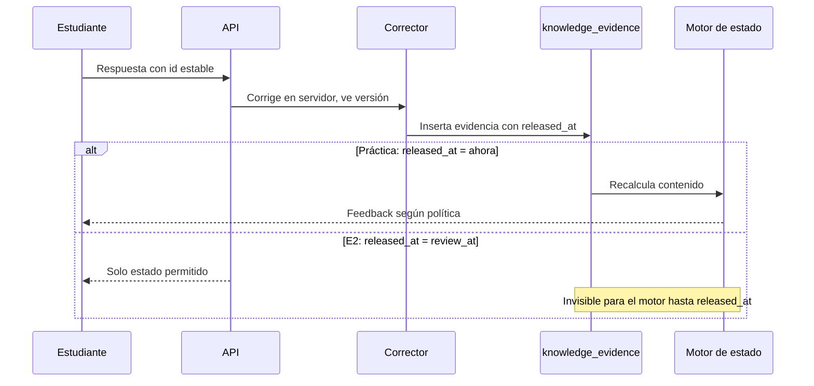
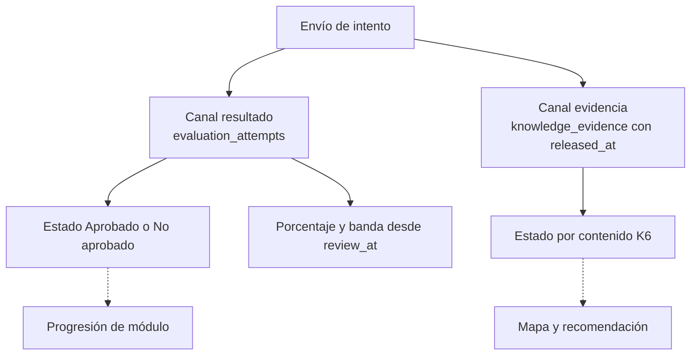
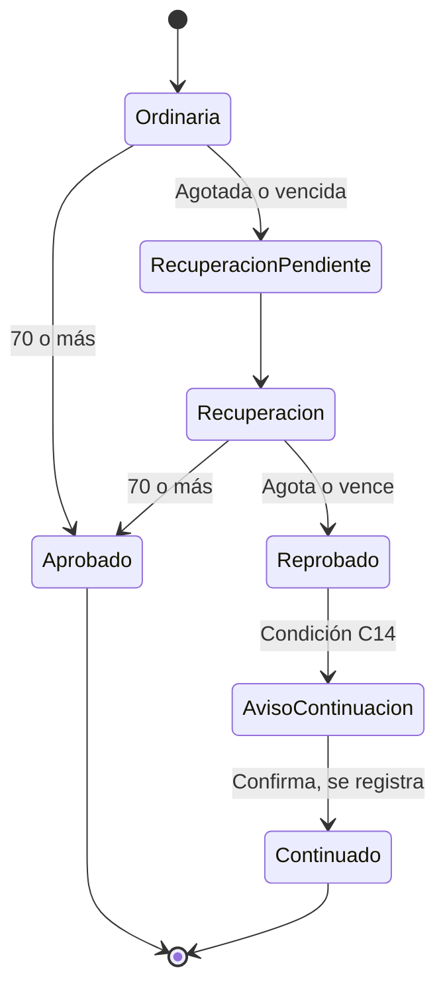

# 03. Motor de evidencias y relación con P0-E

**Estado:** PROPUESTO. Donde hay decisión pedagógica: alternativas y recomendación, sin imponerla. Reglas P0-E: especificación maestra, no se modifican.

## 1. Qué es evidencia

Una **evidencia** es una respuesta corregida en el servidor, a una pregunta versionada y aprobada, asociada a un contenido.

| Fuente | ¿Evidencia? | Publicación |
|---|---|---|
| Práctica de banco separado | Sí | Inmediata |
| Comprobación de retención | Sí | Inmediata |
| E1, E3, E4 | Sujeto a C6, N4, P16 | Ver §8 |
| E2 ordinaria y recuperación | Sujeto a N2 | Embargada hasta `review_at` |
| Formularios externos | **No** (sin respuesta por pregunta; P8) | No aplica |
| Copiloto | **No** | No aplica |
| Video o lectura abiertos, tiempo | **No**: exposición, no dominio | No aplica |
| Registros antiguos `evaluation_progress` | **No** por omisión (N6) | No aplica |
| Reflexiones y portafolio | No en etapa 1; requieren rúbrica | No aplica |

**Flujo:**

## 2. Asociación respuesta → contenido

La respuesta apunta a `question_version_id`; esta, a su familia; la familia, a un contenido. La evidencia copia esos identificadores al insertarse (fotografía), para que una edición futura no cambie el pasado. Una pregunta sin contenido aprobado no se puede publicar (K4).

## 3. Práctica frente a evaluación

| | Práctica | Evaluación P0-E |
|---|---|---|
| Propósito | Aprender | Certificar |
| Intentos | Sin límite P0-E (ritmo: política) | 2/3/2/2 y recuperación con 2 |
| Feedback | Inmediato por contenido | Solo estado, hasta `review_at` |
| Banco | `bank = practica` | `bank = evaluacion` |
| Registro | `practice_attempts` | `evaluation_attempts` |

**Separación de bancos, garantizada en base de datos.** Cada familia pertenece a un banco para siempre. Una clave foránea compuesta `(family_id, bank)` con `CHECK (bank = 'practica')` impide que la práctica use una pregunta de evaluación, y viceversa. Ver [04](04_MODELO_DE_DATOS.md). Una versión de evaluación retirada no pasa a práctica. Esto reemplaza la dependencia provisional de `server/repaso.ts` (C11).

## 4. Preguntas generadas con IA (K13)

- EXISTE EN CÓDIGO: `aiEvaluationGenerator.ts` guarda preguntas en `questions_json` sin revisión humana previa ni contenido.
- PROPUESTO: flujo `borrador → en_revision → aprobada → retirada`. `aprobada` exige `reviewed_by` humano, por `CHECK`. Se guarda el origen: `humano` o `ia`, modelo y huella del prompt.
- Solo `aprobada` se entrega. Editar una aprobada crea versión nueva.
- La IA nunca marca revisión, crea aristas ni define contenidos publicados.
- Las preguntas existentes en `questions_json` no se importan solas: pasan por el mismo flujo.

## 5. Preguntas casi iguales (N9)

**Mecanismo:** la familia es la unidad de independencia. K6 cuenta **familias** distintas, no preguntas. Cambiar los números de una misma plantilla es otra versión o variante de la misma familia.

| Alternativa | Consecuencia |
|---|---|
| **A. Familia asignada por revisor humano, con detector de apoyo (recomendada)** | Criterio pedagógico explícito. Requiere trabajo editorial |
| B. Detector automático de similitud decide | Barato; se equivoca con preguntas cortas |
| C. Toda pregunta distinta cuenta | Infla el dominio |

Detector (determinista, solo aviso): normaliza texto, reemplaza números por marcador y compara palabras. Reutiliza la idea de `matchesEvaluationQuestion` de `shared/iaPolicy.ts`.

## 6. Respuesta asistida y error posterior

**Ayuda (O3).** Campo `assistance`: `ninguna`, `pista`, `explicacion_vista`, `copiloto_en_sesion`, `tutor`. Ajuste de accesibilidad va aparte: `accommodation` (O9). **No se confunde apoyo de accesibilidad con ayuda.**

| Alternativa | Consecuencia |
|---|---|
| **A. Solo cuenta para K6 lo que no tuvo ayuda; lo demás se guarda (recomendada)** | Protege «autónomo». Más práctica |
| B. Cuenta con peso menor | Requiere pesos sin evidencia |
| C. Todo cuenta | Dominio inflado |

**Límite:** el servidor no ve ayuda externa (familia, otra pestaña). K6 es evidencia, no certeza. `copiloto_en_sesion` usa solo una marca de tiempo por sesión, sin leer la conversación.

**Error posterior al dominio.** La evidencia se inserta; no se borra nada.

| Alternativa | Consecuencia |
|---|---|
| **A. Sigue `dominado` con `por_comprobar` y comprobación próxima; con 2 errores en familias distintas sin acierto posterior, pasa a `incierto` (recomendada)** | Tolera descuido, reacciona a patrón |
| B. Un error lo baja a `incierto` | Sensible a ruido; desmotiva |
| C. Dominio permanente | Ignora retención |

## 7. Estado «no dominado» e incertidumbre

**O1.**

| Alternativa | Regla |
|---|---|
| **A (recomendada)** | Errores en al menos 2 familias distintas y menos de 2 correctas válidas |
| B | Solo si falla también el prerrequisito inmediato |
| C | No existe; todo es «por aprender» |

**Incertidumbre, versión 1 (determinista).** No hay probabilidad ni porcentaje. Se guardan hechos y un motivo:

| Campo | Ejemplo |
|---|---|
| `correct_families`, `wrong_families`, `assisted_count` | conteos |
| `last_evidence_at`, `last_retention_ok_at` | fechas |
| `uncertainty_reason` | `pocas_evidencias`, `contradictoria`, `solo_con_ayuda`, `retencion_vencida`, `banco_insuficiente` |

Al estudiante no se le muestra probabilidad (O6). Una probabilidad real exige datos y calibración: [05](05_ALGORITMOS_Y_RECOMENDACIONES.md) §6.

## 8. Convivencia con P0-E

**Principio.** Dos canales independientes: el **resultado** de la evaluación (P0-E) y el **estado** por contenido. Ninguno se calcula desde el otro.

### 8.1 K6 y 70 % (N1)

| Situación posible | Evaluación | Contenido |
|---|---|---|
| Aprueba E2, falla 2 preguntas de C | Aprobada | C sin cambio o con errores |
| No aprueba E2, pero domina en práctica | No aprobada | `dominado` |
| Aprueba E2 con 1 pregunta por contenido | Aprobada | 1 sola familia: K6 no se cumple |

| Alternativa | Consecuencia |
|---|---|
| **A. Independientes; E2 solo aporta evidencia por pregunta (recomendada)** | No cambia reglas aprobadas. Puede haber casos que requieren explicación |
| B. Aprobar E2 marca todo el módulo `dominado` | Contradice K6 |
| C. Exigir dominio para aprobar o rendir E2 | Cambia P0-E; requiere decisión expresa |

### 8.2 E1 a E4

| Evaluación | Regla aprobada | Conflicto | Diseño |
|---|---|---|---|
| E1, E3, E4 | 2 intentos, estado inmediato, pauta diferida | K11 pide feedback inmediato: C6. P16 sin aprobar | `evaluation_function` y `release_policy` como datos (nulos hasta P16) |
| E2 | 3 intentos, recuperación con 2 | P21, C3 | Evidencia embargada |

**Alternativas C6 / N4:**

| Alternativa | Cumple K11 | Cumple regla aprobada |
|---|---|---|
| **A. Feedback inmediato en banco de práctica separado; E1, E3, E4 conservan estado hasta `review_at` (recomendada)** | Parcial: mismo fin, otro lugar | Sí |
| B. Feedback por contenido inmediato en E1, E3, E4 | Sí | No: requiere enmendar la maestra y aceptar riesgo, sobre todo si otros siguen respondiendo la versión |
| C. Como B, solo al cerrar la instancia del estudiante | Parcial | No sin enmienda: la ventana sigue abierta para otros |

### 8.3 Embargo: que el mapa no revele E2

`released_at` se fija al insertar: `review_at` de la instancia (recuperación: el suyo). **Toda** lectura del motor filtra `released_at <= ahora del servidor`.

| Alternativa N2 | Consecuencia |
|---|---|
| **A. E2 es evidencia, embargada (recomendada)** | Aprovecha datos; cumple C7 |
| B. E2 nunca es evidencia | Más simple y seguro; desperdicia datos; K6 depende solo de práctica |
| C. E2 actualiza de inmediato | **No viable**: filtra la pauta |

**Prueba de no interferencia (obligatoria):** dos estudiantes ficticios idénticos responden distinto en E2. Hasta `review_at`, mapa, recomendaciones, notificaciones y vistas de familia y tutor deben ser **byte a byte iguales** (salvo el estado permitido).

**Sobre el estudiante con E2 embargada:** si practica mientras, el mapa avanza solo con práctica. No se bloquea el contenido por E2 abierta. P10 sigue pendiente para el repaso de preguntas evaluativas, que aquí no se usa.

### 8.4 Publicación tras `review_at`

Sujeto a D1–D4: porcentaje real del intento que cuenta (Q: mejor o último, sin definir; la maestra no lo fija: N14), banda y contenidos a reforzar. La pauta sigue P19, de solo lectura. Durante el proceso solo estado.

### 8.5 Contenidos a reforzar (C8)

| Alternativa | Regla |
|---|---|
| **A. Contenidos del módulo no `dominado` con al menos un error liberado (recomendada)** | Una sola fuente: el estado. Evita dos criterios |
| B. Menos de 70 % por contenido en el intento (propuesta previa en `PROGRESO` §4) | Necesita varias preguntas por contenido (N5, Q4) |
| C. Ambos, mostrados por separado | Confuso |

Sin contenidos etiquetados (fuera del piloto), solo se muestra el nivel módulo; no se inventa detalle.

### 8.6 P21 (COMUNICADO, requiere D2 y C15)

- `progression_continuations`: una fila por proceso. Guarda fotografía de contenidos pendientes, recursos ofrecidos y confirmación. El resultado no cambia.
- **No** marca dominados, no reescribe nada. El módulo abierto muestra los contenidos sin base como `requiere base`, y se pueden abrir (C9, alternativa recomendada en [10](10_DECISIONES_PENDIENTES.md)).
- **C14:** recomendado: continuar solo desde `review_at` de la recuperación, para no adelantar contenidos.
- Depende del núcleo P0-E. Fuera de piloto la lista es de módulo.
