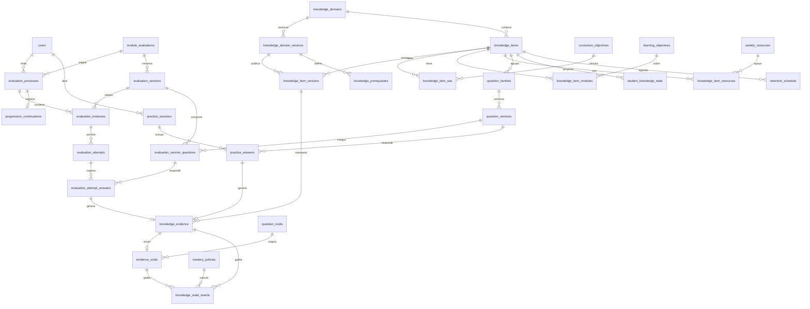

# 04. Modelo de datos

**Estado:** PROPUESTO (versión corregida tras auditoría). NO EXISTE en el esquema. No se ejecutó ninguna migración. Motor: libSQL/Turso con Drizzle (EXISTE EN CÓDIGO). Fechas: enteros `timestamp` UTC, como el esquema actual. Ids: `text` UUID. El SQL es conceptual: **no se ha ejecutado**.

## 1. Principio: la consistencia la garantiza la base de datos

Una evidencia debe corresponder al mismo estudiante, contenido, familia, versión de pregunta, resultado y ayuda que la respuesta que la originó. Para eso, esos datos se copian y se atan con **claves foráneas compuestas** a una clave `UNIQUE` del padre. Si una columna difiere, la inserción falla. SQLite no aplica una FK compuesta si alguna columna es NULL (`MATCH SIMPLE`): eso permite una FK por cada origen, y un `CHECK` exige exactamente uno.

**Dependencia crítica (RIESGO TÉCNICO):** requiere `PRAGMA foreign_keys = ON` en cada conexión. No aparece en `server/`, `shared/` ni `script/`. No se verificó el comportamiento en Turso. Si no se aplica, nada de esto protege. Prueba D1.

## 2. Diagrama



## 3. Dependencia con P0-E

`evaluation_processes`, `evaluation_instances`, `evaluation_versions` y `evaluation_attempts` concretan las entidades de `DISENO_TECNICO_PROPUESTO_MAQUINA_ESTADOS.md` (rama `docs/p0-e-maestro`), que es PROPUESTA y dice no crear tablas todavía. Aquí no se aprueban ni se cambian reglas. Las columnas marcadas **[K]** las añade este modelo para enlazar la evidencia. Lotes, excepciones y sustituciones (`recovery_batches`, `evaluation_exceptions`) siguen pendientes (P20-v, P25, P18-v) y no se detallan.

## 4. Tipos de tabla

| Tipo | Tablas | Regla |
|---|---|---|
| **Solo inserción** | `knowledge_evidence`, `evidence_voids`, `question_voids`, `knowledge_state_events`, `recommendation_log`, `governance_audit`, `progression_continuations`, `practice_answers`, `evaluation_attempt_answers` | Trigger `BEFORE UPDATE/DELETE → RAISE(ABORT)` |
| **Inmutable tras publicar** | `knowledge_domain_versions` y sus `knowledge_item_versions` y `knowledge_prerequisites`; `question_versions` `aprobada`; `evaluation_versions` `validada`; `mastery_policies` `aprobada` | Trigger: solo permite la transición de `status` |
| **Máquina de estados** | `evaluation_processes`, `evaluation_instances`, `evaluation_attempts`, `practice_sessions` | Actualizable solo por transiciones; un intento `enviado` no cambia |
| **Proyección** | `student_knowledge_state`, `retention_schedule` | Actualizable; reconstruible |
| **Catálogo** | `curriculum_objectives`, `knowledge_domains`, `knowledge_items`, `question_families`, tablas de vínculo | Cambios en `governance_audit` |

La purga legal futura (O10) chocaría con «solo inserción»: exige una vía excepcional, sin definir. `practice_answers` y `evaluation_attempt_answers` son solo inserción: si se adopta guardado parcial (propuesto en P0-E), los borradores van en otra tabla y estas guardan lo enviado.

## 5. Diccionario de datos

`PK` primaria, `FK` foránea, `NN` no nula. Toda FK a `users` usa `ON DELETE RESTRICT`.

### 5.1 Conocimiento

| Tabla | Columna | Tipo | Notas |
|---|---|---|---|
| `curriculum_objectives` | `id` | text PK | |
| | `level_subject_id` | text NN FK `level_subjects` | |
| | `official_code`, `text`, `source_url`, `source_year` | NN | UNIQUE (subject, code, year) |
| | `verified_by`, `verified_at` | | Persona |
| `knowledge_domains` | `id`; `level_subject_id` NN FK; `name` NN | | |
| `knowledge_domain_versions` | `id` PK; `domain_id` NN FK; `version` int NN | | UNIQUE (domain, version) |
| | `status` | enum NN | `borrador, en_revision, validada, publicada, retirada`; único parcial: una `publicada` por dominio |
| | `created_by`, `validated_by`, `published_at` | | CHECK `validated_by <> created_by`; requerido desde `validada` |
| `knowledge_items` | `id` PK; `domain_id` NN FK; `code` NN | | UNIQUE (domain, code) |
| `knowledge_item_versions` | `id` PK; `item_id`, `domain_version_id` NN FK | | UNIQUE (item, domain_version) y UNIQUE (id, item, domain_version) |
| | `name`, `operational_definition` | NN | |
| | `supersedes_version_id` | FK propia | Versión anterior |
| | `evidence_continuity` | enum | `compatible, ruptura`; requerido si hay anterior. Ver §8 |
| | `continuity_decided_by` | | Persona |
| `knowledge_prerequisites` | `id` PK; `domain_version_id`, `item_id`, `prerequisite_item_id` NN FK | | UNIQUE (version, item, prereq); CHECK distintos |
| | `relation` | enum NN | `necesaria, contributiva, alternativa`; CHECK alternativa ⇔ `alt_group` no nulo |
| | `justification`, `confidence`, `validated_by`, `validated_at` | NN | Sin aristas sin validador |
| `knowledge_item_oas` | `item_id`, `curriculum_objective_id` | PK compuesta | |
| `knowledge_item_modules` | `item_id`, `learning_objective_id` | PK compuesta | |
| `knowledge_item_resources` | `item_id`, `resource_id`, `role` | PK compuesta | |

### 5.2 Banco

| Tabla | Columna | Notas |
|---|---|---|
| `question_families` | `id` PK; `item_id` NN FK; `bank` NN; `label` | CHECK bank; UNIQUE (id, item_id, bank) |
| `question_versions` | `id` PK; `family_id`, `item_id`, `bank` NN; `version` | FK (family_id, item_id, bank) → familias; UNIQUE (family, version); UNIQUE (id, family_id, item_id, bank) |
| | `status` | `borrador, en_revision, aprobada, retirada`; CHECK `aprobada/retirada` ⇒ `reviewed_by` |
| | `stem`, `options_json`, `correct_option_id`, `explanation` | Ids estables; nunca posición |
| | `origin`, `ai_model`, `prompt_hash`, `content_hash`, `authored_by`, `reviewed_by`, `reviewed_at` | CHECK `reviewed_by <> authored_by` |

### 5.3 Evaluación (dependiente de P0-E)

| Tabla | Columna | Notas |
|---|---|---|
| `evaluation_versions` | `id` PK; `evaluation_id` NN FK `module_evaluations`; `version`; `status` | `borrador, validada, asignada, retirada`; UNIQUE (evaluation, version) y (id, evaluation_id) |
| `evaluation_version_questions` | `evaluation_version_id`, `question_version_id` | PK compuesta; más `family_id`, `item_id`, `bank`, `position`; **CHECK `bank='evaluacion'`**; FK (qv, family, item, bank) → `question_versions` |
| `evaluation_processes` | `id` PK; `student_id`, `evaluation_id` NN FK; `status`; `closed_at`; `close_cause` | `abierto, recuperacion_pendiente, recuperacion_abierta, aprobado, reprobado`; UNIQUE (student, evaluation) |
| `evaluation_instances` | `id` PK; `process_id`, `student_id`, `evaluation_version_id` NN | FK (process, student) |
| | `phase` | `ordinaria, recuperacion` |
| | `window_end_at`, `extension_ends_at`, `review_at`, `time_zone`, `max_attempts` | NN |
| | `status`, `close_cause` | Propuesta P0-E |
| | UNIQUE (id, student_id, evaluation_version_id, review_at) | Para FK de intentos |
| `evaluation_attempts` | `id` PK; `instance_id`, `student_id`, `evaluation_version_id`, `review_at` | FK compuesta a instancia; **copias [K]** |
| | `attempt_number`, `status`, `permutation_json`, `started_at`, `expires_at`, `submitted_at`, `submission_id` | Único parcial: un `activo` por instancia. UNIQUE (instance, attempt_number). UNIQUE (submission_id) |
| | `score_pct`, `total_correct`, `total_questions`, `passed` | **Solo servidor**; P9 |
| | `evidence_source_type` **[K]** | `evaluacion_practica, evaluacion_cierre, recuperacion` |
| | UNIQUE (id, student_id, evaluation_version_id, evidence_source_type, review_at) | |
| `evaluation_attempt_answers` | `id` PK; `attempt_id`, `student_id`, `evaluation_version_id`, `evidence_source_type`, `review_at` | FK compuesta a intento |
| | `question_version_id`, `family_id`, `item_id`, `bank` | FK (version, qv) → `evaluation_version_questions`, garantiza que la pregunta integra la versión; FK (qv, family, item, bank) |
| | `selected_option_id`, `is_correct`, `answered_at` | UNIQUE (attempt, qv) |
| | UNIQUE (id, student_id, qv, family, item, is_correct, evidence_source_type, review_at) | Para evidencia |

`module_evaluations` requeriría `evaluation_function` y `release_policy`, ambos nulos (P16). `evaluation_progress` conserva el histórico (P7), con `attempt_id` nulo en filas antiguas. EXISTE EN CÓDIGO: una fila por envío, sin intentos.

### 5.4 Práctica

| Tabla | Columna | Notas |
|---|---|---|
| `practice_sessions` | `id` PK; `student_id` NN FK; `domain_version_id` NN; `purpose`; `started_at`, `ended_at` | `practica, retencion`; UNIQUE (id, student_id, purpose) |
| `practice_answers` | `id` PK; `session_id`, `student_id`, `purpose` | FK (session, student, purpose) |
| | `question_version_id`, `family_id`, `item_id`, `bank` | FK a versión; **CHECK `bank='practica'`** |
| | `selected_option_id`, `is_correct`, `assistance`, `accommodation`, `client_submission_id`, `answered_at` | UNIQUE (student, client_submission_id) |
| | UNIQUE (id, student_id, qv, family, item, is_correct, assistance, purpose) | Para evidencia |

### 5.5 Evidencia y estado

| Tabla | Columna | Notas |
|---|---|---|
| `knowledge_evidence` | `id` PK; `student_id`, `item_id`, `family_id`, `question_version_id`, `item_version_id`, `domain_version_id` | NN; FK (item_version, item, domain_version) |
| | `source_type` | `practica, retencion, evaluacion_practica, evaluacion_cierre, recuperacion` |
| | `practice_answer_id`, `attempt_answer_id` | Un origen. Únicos parciales: una evidencia por respuesta |
| | `is_correct`, `assistance`, `accommodation`, `review_at`, `occurred_at`, `released_at` | Copias atadas por FK |
| `question_voids` | `id` PK; `question_version_id` NN; `reason`, `requested_by`, `approved_by`, `at` | UNIQUE (qv); CHECK personas distintas. Decisión de anular |
| `evidence_voids` | `id` PK; `evidence_id` NN FK; `question_void_id` FK; `reason`, `requested_by`, `approved_by`, `at` | UNIQUE (evidence). CHECK distintos, o con `question_void_id` |
| `mastery_policies` | `id` PK; `version` UNIQUE; `rules_json`; `status`; `approved_by`, `approved_at` | Aprobada: sin parámetros nulos (lo valida la aplicación) |
| `knowledge_state_events` | `id` PK; `student_id`, `item_id`; `from_state`, `to_state`, `from_flag`, `to_flag`; `reason` | `reason`: `evidencia, liberacion, anulacion, nueva_version, cambio_politica, retencion_vencida` |
| | `trigger_evidence_id`, `trigger_void_id`, `policy_id`, `domain_version_id`, `computed_at`, `effective_at` | CHECK: según `reason` |
| `student_knowledge_state` | PK (`student_id`, `item_id`); `state`, `flag`, `correct_families`, `wrong_families`, `assisted_count`, `uncertainty_reason`, `mastered_at`, `last_evidence_at`, `policy_id`, `domain_version_id`, `computed_through`, `updated_at` | **Proyección**. `computed_through`: hasta qué `released_at` incluye; ver [08](08_SEGURIDAD_Y_GOBIERNO.md) §7.3 |
| `retention_schedule` | PK (`student_id`, `item_id`); `step`, `due_at`, `last_checked_at`, `last_result` | **Proyección** |
| `progression_continuations` | `id` PK; `student_id`, `process_id`; `from_module_id`, `pending_items_json`, `offered_resources_json`, `acknowledged_at` | UNIQUE (process); FK (process, student) |
| `recommendation_log`, `governance_audit` | Como en la versión previa | |

## 6. Restricciones (SQL conceptual, no ejecutado)

```sql
CREATE TABLE knowledge_evidence (
  id TEXT PRIMARY KEY,
  student_id TEXT NOT NULL, item_id TEXT NOT NULL, family_id TEXT NOT NULL,
  question_version_id TEXT NOT NULL, item_version_id TEXT NOT NULL, domain_version_id TEXT NOT NULL,
  source_type TEXT NOT NULL,
  practice_answer_id TEXT, attempt_answer_id TEXT,
  is_correct INTEGER NOT NULL, assistance TEXT NOT NULL, accommodation TEXT,
  review_at INTEGER, occurred_at INTEGER NOT NULL, released_at INTEGER NOT NULL,

  -- Correspondencia source_type ↔ origen
  CHECK (
    (source_type IN ('practica','retencion')
       AND practice_answer_id IS NOT NULL AND attempt_answer_id IS NULL
       AND review_at IS NULL AND released_at = occurred_at)
    OR
    (source_type IN ('evaluacion_practica','evaluacion_cierre','recuperacion')
       AND attempt_answer_id IS NOT NULL AND practice_answer_id IS NULL
       AND assistance = 'ninguna'
       AND review_at IS NOT NULL AND released_at = review_at)
  ),
  -- Mismos datos que la respuesta de origen
  FOREIGN KEY (practice_answer_id, student_id, question_version_id, family_id, item_id,
               is_correct, assistance, source_type)
    REFERENCES practice_answers (id, student_id, question_version_id, family_id, item_id,
               is_correct, assistance, purpose),
  FOREIGN KEY (attempt_answer_id, student_id, question_version_id, family_id, item_id,
               is_correct, source_type, review_at)
    REFERENCES evaluation_attempt_answers (id, student_id, question_version_id, family_id, item_id,
               is_correct, evidence_source_type, review_at),
  FOREIGN KEY (item_version_id, item_id, domain_version_id)
    REFERENCES knowledge_item_versions (id, item_id, domain_version_id)
);
CREATE UNIQUE INDEX ke_practice_uq ON knowledge_evidence (practice_answer_id) WHERE practice_answer_id IS NOT NULL;
CREATE UNIQUE INDEX ke_attempt_uq  ON knowledge_evidence (attempt_answer_id)  WHERE attempt_answer_id  IS NOT NULL;
CREATE INDEX ke_read ON knowledge_evidence (student_id, item_id, released_at);

CREATE TRIGGER ke_no_update BEFORE UPDATE ON knowledge_evidence
BEGIN SELECT RAISE(ABORT, 'knowledge_evidence es solo inserción'); END;
CREATE TRIGGER ke_no_delete BEFORE DELETE ON knowledge_evidence
BEGIN SELECT RAISE(ABORT, 'knowledge_evidence es solo inserción'); END;

-- La pregunta debe estar aprobada al responder (una FK no ve el estado)
CREATE TRIGGER pa_only_approved BEFORE INSERT ON practice_answers
WHEN (SELECT status FROM question_versions WHERE id = NEW.question_version_id) <> 'aprobada'
BEGIN SELECT RAISE(ABORT, 'pregunta no aprobada'); END;
```

**Notas:**
- `assistance = 'ninguna'` en evaluación: el servidor no puede saber si hubo ayuda externa. Significa «sin ayuda de la plataforma».
- `review_at` fijo por instancia. Una excepción crea otra instancia (P18). Si una ampliación dentro de la extensión cambiara `review_at`, estas copias fallarían: prueba D6 y decisión técnica.
- `source_type`, `purpose` y `evidence_source_type` comparten valores; por eso la FK funciona (`practica`, `retencion` en práctica).
- Que el dominio de la evidencia sea el publicado en ese momento lo valida la aplicación, en la transacción.
- La evidencia se inserta en el mismo `db.batch` que la respuesta. Sin esto podrían quedar respuestas sin evidencia; es detectable por reconciliación.

## 7. Ejemplos (HIPOTÉTICOS; ids ficticios)

**Válidos**

```json
{ "practice_answers": { "id": "pa-1", "session_id": "s-1", "student_id": "ficticio-1", "purpose": "practica",
    "question_version_id": "qv-a1", "family_id": "fam-a1", "item_id": "item-hip-a", "bank": "practica",
    "selected_option_id": "op-2", "is_correct": 1, "assistance": "ninguna" } }
```
```json
{ "knowledge_evidence": { "id": "ev-1", "student_id": "ficticio-1", "item_id": "item-hip-a", "family_id": "fam-a1",
    "question_version_id": "qv-a1", "source_type": "practica", "practice_answer_id": "pa-1", "attempt_answer_id": null,
    "is_correct": 1, "assistance": "ninguna", "review_at": null,
    "occurred_at": 1800000000, "released_at": 1800000000 } }
```
```json
{ "knowledge_evidence": { "id": "ev-2", "source_type": "evaluacion_cierre", "attempt_answer_id": "aa-77",
    "practice_answer_id": null, "assistance": "ninguna", "is_correct": 0,
    "review_at": 1800300000, "released_at": 1800300000 } }
```

**Inválidos: la base debe rechazarlos**

| # | Intento | Lo impide |
|---|---|---|
| 1 | Evidencia de `ficticio-2` con `pa-1` (de `ficticio-1`) | FK compuesta |
| 2 | `is_correct = 1` con respuesta incorrecta | FK compuesta |
| 3 | `family_id` o `item_id` distintos de la respuesta | FK compuesta |
| 4 | `source_type='practica'` con `attempt_answer_id` | CHECK |
| 5 | Sin origen, o con ambos | CHECK |
| 6 | `evaluacion_cierre` con `released_at` < `review_at` | CHECK y FK |
| 7 | `practice_answers` con `bank='evaluacion'` | CHECK |
| 8 | Pregunta de banco práctica en `evaluation_version_questions` | CHECK |
| 9 | Respuesta de intento con pregunta ajena a su versión | FK a `evaluation_version_questions` |
| 10 | Segunda evidencia para una misma respuesta | Único parcial |
| 11 | `UPDATE` o `DELETE` de evidencia | Trigger |
| 12 | Respuesta a pregunta en `borrador` | Trigger |
| 13 | `question_versions` `aprobada` sin revisor, o revisor = autor | CHECK |
| 14 | Segundo intento `activo` en la instancia | Único parcial |
| 15 | Anulación con solicitante = aprobador | CHECK |

**La base no puede impedir:** una familia mal asignada, un contenido mal definido, ayuda externa. Son controles humanos.

## 8. Historial, versiones y anulaciones

**Nueva versión de contenido o dominio.** Evidencias y eventos no cambian; siguen citando su `item_version_id`. Al publicar:
- `evidence_continuity = compatible`: la evidencia anterior sigue contando.
- `ruptura`: no cuenta para K6. Recálculo con eventos `nueva_version`.
Lo decide una persona, por contenido. Comportamiento y alternativas: [03](03_MOTOR_DE_EVIDENCIAS.md) §9, escenario 9.

**Anulación.** Inserta `evidence_voids` (y `question_voids`, si afecta a todas). No borra. Efecto en la reconstrucción:
1. `evaluar` excluye evidencia anulada; el dominio puede revertirse.
2. Se inserta un evento `anulacion` si cambia el estado.
3. Evidencia embargada: anulada sin efecto visible antes de `released_at`.
4. **No altera** resultados P0-E, intentos ni `score_pct` (N12).
5. La anulación no se puede deshacer borrando. Revertirla: decisión pendiente; propuesta: tabla de reversión.

**Reconstrucción:** `student_knowledge_state` = reproducir evidencias liberadas no anuladas, con la política y versión vigentes. Eventos históricos no se reescriben.

## 9. Reutilización y migraciones

| Estructura | Situación | Decisión |
|---|---|---|
| `users`, `levels`, `level_subjects`, `subjects`, `enrollments` | EXISTE | Sin cambio |
| `learning_objectives` | EXISTE; es módulo, no OA | Como módulo |
| `weekly_resources`, `student_progress` | EXISTE | Avance de lecciones |
| `module_evaluations` | EXISTE | Aditivo: función y política (P16). `questions_json` sigue para el histórico |
| `evaluation_progress` | EXISTE | Intacto (P7) |
| `learning_events` | EXISTE | Analítica; no evidencia |
| `review_items` | EXISTE; preguntas evaluativas | Fuera del piloto (C11) |
| `user_profiles`, `guardian_links`, `tutoring_cases` | EXISTE | Reutilizar; falta rol revisor |
| Todo lo demás | NO EXISTE | Migración aditiva, autorización aparte |

## 10. Dependencias que requieren pruebas

Todas en base desechable, con autorización. **Ninguna ejecutada.**

| ID | Prueba |
|---|---|
| D1 | `PRAGMA foreign_keys`: ¿se aplica por conexión en libSQL y Turso, incluido `db.batch` y conexiones HTTP? |
| D2 | FK compuesta a `UNIQUE` con varias columnas y NULL (`MATCH SIMPLE`) |
| D3 | Declarar FK compuestas y CHECK en Drizzle 0.39 y `drizzle-kit`; triggers solo por SQL propio |
| D4 | Triggers en Turso y que `db:push` no los elimine. `migrations/` solo tiene `0000`: revisar deriva, sin escribir |
| D5 | Ejecutar todos los inválidos de §7 |
| D6 | Efecto de una ampliación de ventana en `review_at` copiado |
| D7 | Atomicidad respuesta + evidencia + evento, y concurrencia en réplicas (T1/T2) |
| D8 | Costo de los índices `UNIQUE` anchos |
