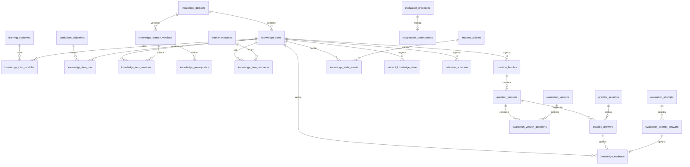

# 04. Modelo de datos

**Estado:** PROPUESTO. No se ejecutó ni se ejecutará migración en esta etapa. Motor: libSQL/Turso con Drizzle (EXISTE EN CÓDIGO). Fechas: enteros `timestamp`, UTC, como el esquema actual. Ids: `text` UUID.

## 1. Diagrama



## 2. Reutilización y migraciones

| Estructura | Situación | Decisión |
|---|---|---|
| `levels`, `level_subjects`, `subjects`, `enrollments` | EXISTE EN CÓDIGO | Se reutilizan sin cambio |
| `learning_objectives` | EXISTE; es módulo, no OA | Se reutiliza como módulo |
| `weekly_resources`, `student_progress` | EXISTE | Se reutilizan. Avance de lecciones |
| `module_evaluations` | EXISTE | Sigue. Migración aditiva: `evaluation_function`, `release_policy`, ambos nulos (P16) |
| `evaluation_progress` | EXISTE | Histórico intacto (P7). Para P0-E: `attempt_id` nulo (ya propuesto) |
| `learning_events` | EXISTE | Sigue para analítica. **No** es evidencia |
| `review_items` | EXISTE; usa preguntas evaluativas | Congelado en piloto; retiro con autorización (C11) |
| `user_profiles`, `guardian_links`, `tutoring_cases` | EXISTE | Se reutilizan |
| Núcleo P0-E | NO EXISTE | Propuesto en `DISENO_TECNICO_PROPUESTO_MAQUINA_ESTADOS.md`; aquí solo se indican las columnas de enlace |
| Todo lo de §3 | NO EXISTE | Migración aditiva, autorización separada |

## 3. Tablas nuevas

### Conocimiento

| Tabla | Campos clave | Restricciones |
|---|---|---|
| `curriculum_objectives` | `id`, `level_subject_id` FK, `official_code`, `text`, `source_url`, `source_year`, `verified_by`, `verified_at` | UNIQUE (`level_subject_id`, `official_code`, `source_year`) |
| `knowledge_domains` | `id`, `level_subject_id` FK, `name`, `created_at` | |
| `knowledge_domain_versions` | `id`, `domain_id` FK, `version` int, `status`, `published_at`, `validated_by`, `created_by` | UNIQUE (`domain_id`, `version`); índice único parcial: una `publicada` por dominio; CHECK estado; CHECK `validated_by IS NOT NULL` si `validada` o `publicada` |
| `knowledge_items` | `id`, `domain_id` FK, `code` | UNIQUE (`domain_id`, `code`) |
| `knowledge_item_versions` | `id`, `item_id` FK, `domain_version_id` FK, `name`, `operational_definition`, `mastery_notes`, `common_errors_json` | UNIQUE (`item_id`, `domain_version_id`) |
| `knowledge_prerequisites` | `id`, `domain_version_id` FK, `item_id` FK, `prerequisite_item_id` FK, `relation`, `alt_group`, `justification`, `confidence`, `validated_by`, `validated_at` | UNIQUE (versión, item, prereq); CHECK `item_id <> prerequisite_item_id`; CHECK (`relation='alternativa'`) = (`alt_group IS NOT NULL`) |
| `knowledge_item_oas` | `item_id` FK, `curriculum_objective_id` FK | PK compuesta |
| `knowledge_item_modules` | `item_id` FK, `learning_objective_id` FK | PK compuesta |
| `knowledge_item_resources` | `item_id` FK, `resource_id` FK, `role` | PK (`item_id`, `resource_id`, `role`) |

### Banco

| Tabla | Campos clave | Restricciones |
|---|---|---|
| `question_families` | `id`, `item_id` FK, `bank`, `label`, `created_by` | CHECK `bank IN ('practica','evaluacion')`; UNIQUE (`id`, `bank`) para FK compuesta |
| `question_versions` | `id`, `family_id`, `bank`, `version`, `status`, `stem`, `options_json`, `correct_option_id`, `explanation`, `origin`, `ai_model`, `prompt_hash`, `content_hash`, `authored_by`, `reviewed_by`, `reviewed_at` | FK (`family_id`, `bank`) → `question_families`; UNIQUE (`family_id`, `version`); UNIQUE (`id`, `bank`); CHECK `status<>'aprobada' OR reviewed_by IS NOT NULL`; `correct_option_id` estable, nunca posición |
| `evaluation_version_questions` | `evaluation_version_id` FK, `question_version_id`, `bank`, `position` | FK (`question_version_id`, `bank`); **CHECK `bank='evaluacion'`** |
| `practice_sessions` | `id`, `student_id` FK, `domain_version_id` FK, `purpose`, `started_at`, `ended_at`, `copilot_used_at` | índice (`student_id`, `started_at`) |
| `practice_answers` | `id`, `session_id` FK, `student_id` FK, `question_version_id`, `bank`, `selected_option_id`, `is_correct`, `assistance`, `accommodation`, `client_submission_id`, `answered_at` | FK (`question_version_id`, `bank`); **CHECK `bank='practica'`**; UNIQUE (`student_id`, `client_submission_id`) |

**Política de acceso a columnas:** `correct_option_id` y `explanation` nunca salen en DTO antes de lo permitido; lista blanca como la actual `toStudentQuestions`.

### Evidencia y estado (solo inserción, salvo la proyección)

| Tabla | Campos clave | Restricciones |
|---|---|---|
| `knowledge_evidence` | `id`, `student_id` FK, `item_id` FK, `domain_version_id`, `family_id`, `question_version_id`, `source_type`, `practice_answer_id`, `attempt_answer_id`, `is_correct`, `assistance`, `accommodation`, `occurred_at`, `released_at` | CHECK exactamente una fuente; UNIQUE parcial por cada fuente; índice (`student_id`, `item_id`, `released_at`) |
| `mastery_policies` | `id`, `version`, `rules_json`, `status`, `approved_by`, `approved_at` | UNIQUE (`version`) |
| `knowledge_state_events` | `id`, `student_id`, `item_id`, `from_state`, `to_state`, `flag`, `reason`, `trigger_evidence_id`, `policy_id` FK, `domain_version_id`, `computed_at`, `effective_at` | índice (`student_id`, `item_id`, `computed_at`) |
| `student_knowledge_state` | `student_id`, `item_id`, `state`, `flag`, `correct_families`, `wrong_families`, `assisted_count`, `uncertainty_reason`, `mastered_at`, `last_evidence_at`, `policy_id`, `updated_at` | PK (`student_id`, `item_id`). **Reconstruible** |
| `retention_schedule` | `student_id`, `item_id`, `step`, `due_at`, `last_checked_at`, `last_result` | PK (`student_id`, `item_id`); índice (`student_id`, `due_at`) |
| `progression_continuations` | `id`, `student_id`, `process_id`, `from_module_id`, `pending_items_json`, `offered_resources_json`, `acknowledged_at` | UNIQUE (`process_id`) |
| `recommendation_log` | `id`, `student_id`, `item_id`, `kind`, `reason_json`, `policy_id`, `domain_version_id`, `created_at` | Índice (`student_id`, `created_at`) |
| `evidence_voids` | `id`, `evidence_id` FK, `reason`, `requested_by`, `approved_by`, `at` | UNIQUE (`evidence_id`); CHECK `requested_by <> approved_by`. Anula sin borrar |
| `governance_audit` | `id`, `entity_type`, `entity_id`, `action`, `actor_id`, `before_json`, `after_json`, `reason`, `at` | Solo inserción |

**Enlace P0-E** (propuesta del documento maestro): `evaluation_attempt_answers` requiere: `attempt_id`, `question_version_id`, `selected_option_id`, `is_correct`. `evaluation_versions` reemplaza progresivamente `questions_json`. `review_at` vive en la instancia.

**Solo inserción:** se recomienda `TRIGGER … BEFORE UPDATE/DELETE … RAISE(ABORT)`, escrito en SQL de migración, porque Drizzle no los declara. Las purgas futuras (O10) exigirían una vía excepcional y auditada.

## 4. Ejemplos (HIPOTÉTICOS, con identificadores ficticios)

```json
{ "knowledge_evidence": {
    "id": "ev-001", "student_id": "ficticio-1", "item_id": "item-hip-c",
    "family_id": "fam-ec1", "question_version_id": "qv-ec1-1",
    "source_type": "evaluacion_cierre", "attempt_answer_id": "aa-77", "practice_answer_id": null,
    "is_correct": false, "assistance": "ninguna", "accommodation": null,
    "occurred_at": "2027-03-10T15:00:00Z", "released_at": "2027-03-13T03:59:00Z" } }
```

```json
{ "knowledge_state_events": {
    "student_id": "ficticio-1", "item_id": "item-hip-a", "from_state": "incierto", "to_state": "dominado",
    "reason": "k6_familias_distintas", "trigger_evidence_id": "ev-002",
    "policy_id": "pol-1", "domain_version_id": "dv-1", "computed_at": "2027-03-03T14:00:00Z" } }
```

```json
{ "mastery_policies": { "version": 1, "status": "borrador",
    "rules_json": { "k6_min_families": 2, "assisted_counts": false, "same_session_allowed": null,
      "not_mastered_wrong_families": null, "evidence_sources": null } } }
```

Los `null` son decisiones pendientes (O1, O2, N2): la política no puede pasar a `aprobada` con nulos.

## 5. Riesgos de datos por verificar (RIESGO TÉCNICO)

| Riesgo | Verificación necesaria |
|---|---|
| Solo existe `migrations/0000`, y hay script `db:push`. No se conoce el estado real de las bases | Comparar sin escribir antes de autorizar |
| Soporte en Drizzle y libSQL de FK compuestas, CHECK y triggers | Probar en base desechable (T3 ya cubrió CHECK e índice parcial) |
| `PRAGMA foreign_keys` en libSQL | No aparece en el servidor: comprobar si se aplica. Si no, las FK compuestas no protegen |
| Tamaño de evidencia | Volumen del piloto bajo; revisar al escalar |
| Concurrencia en réplicas Turso | T2 pendiente |
