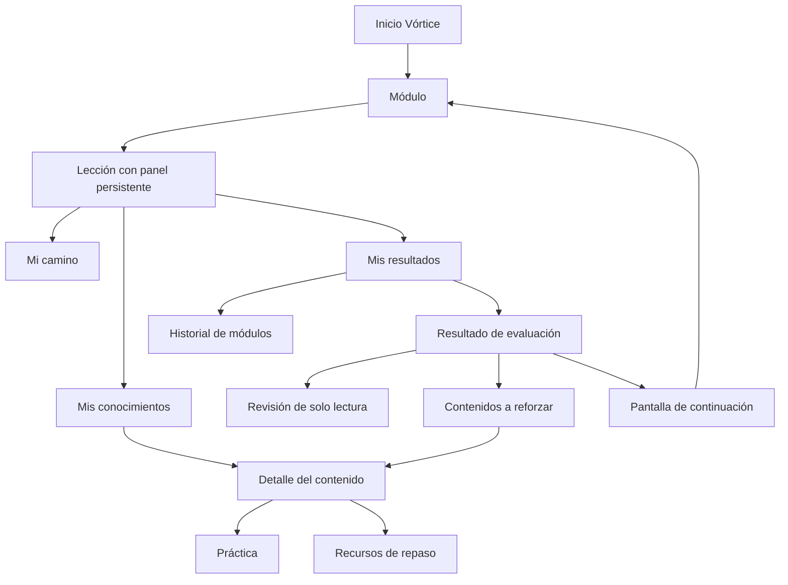
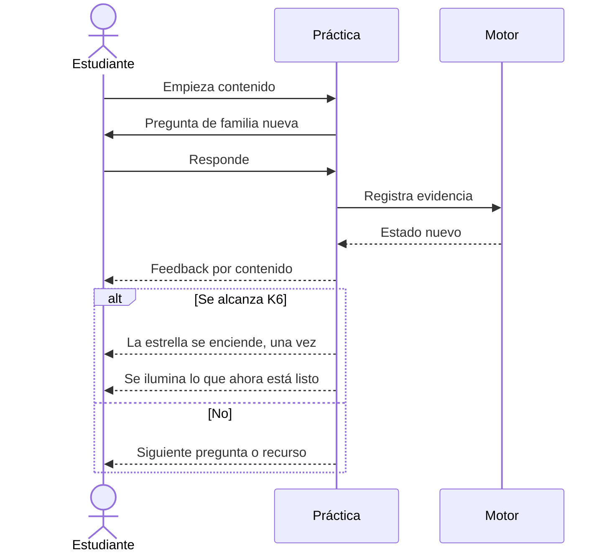
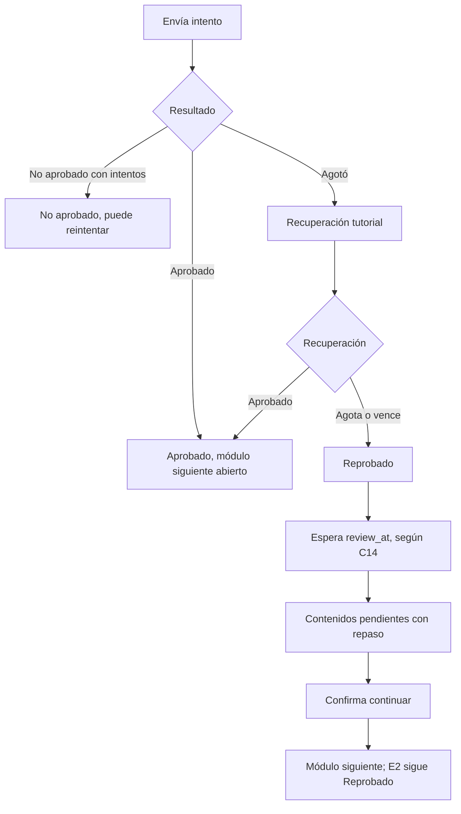

# 06. Experiencia del estudiante

**Estado:** PROPUESTO, sin construir. Requisitos normativos: `docs/p0e/PROGRESO_Y_PROGRESION.md` §5 (CA1–CA10). Piloto: tramo `basica-5-8`. Base visual: diseño de inicio Vórtice aprobado por la dirección (EXISTE EN CÓDIGO: `VorticeInicio.tsx`).

**El piloto funciona sin copiloto:** ninguna pantalla depende de él. El enlace actual «Tutor virtual» de Vórtice sigue sujeto a C19.

**Dato real únicamente.** `{…}` indica valor calculado. EXISTE EN CÓDIGO un gráfico de horas con datos fijos en `CoursePlayer.tsx`, a retirar al implementar.

## 1. Concepto: una lección, tres lentes

Sin barras administrativas: el estudiante siempre está **dentro de un camino**, y puede abrir un panel sin salir.

| Lente | Pregunta | Forma | Fuente | Se mezcla con |
|---|---|---|---|---|
| **Mi camino** | ¿Por dónde voy? | Sendero de estaciones | `student_progress` | Nada |
| **Mis conocimientos** | ¿Qué sé hacer? | Constelación de contenidos conectados | `student_knowledge_state` | Nada |
| **Mis resultados** | ¿Cómo me fue? | Tarjetas de evaluación e historial | P0-E | Nada |

Cada vista tiene su etiqueta y su unidad. Conceptos y fuentes: [01](01_ARQUITECTURA_GENERAL.md) §2.1.

**Conectadas, no mezcladas:**
- **Completar una estación jamás enciende una estrella.** Tras terminar una lección, la pantalla invita: «Comprueba si ya lo dominas», sin afirmarlo.
- Una estrella encendida no marca lección completada, ni habilita nada.
- Una recomendación aparece como sugerencia («Te sugerimos…»). No es un candado. Los candados de módulo solo vienen de P0-E y calendario, y dicen su motivo.
- Si hay contradicción aparente (aprobó E2, contenido no dominado), se explica: «Tu evaluación mide el módulo; cada contenido se confirma por separado».
- Sin total combinado.

## 2. Navegación

**Disposición:** escritorio, panel lateral plegable; móvil, hoja inferior deslizable. Lección y panel conviven: abrirlo no pierde posición en video o lectura.

## 3. Estados visuales

Nunca solo color: icono y texto siempre.

| Contenido | Forma | Texto | Acción |
|---|---|---|---|
| `dominado` | Estrella encendida | «Lo dominas» | Ver |
| `dominado` + `por_comprobar` | Estrella con pulso tenue | «Vamos a comprobarlo» | Comprobar |
| `incierto` (O6) | Estrella a medio trazo | «Sigue practicando» | Practicar |
| Listo | Estrella con halo | «Listo para aprender» | Empezar |
| `no_dominado` (O1) | Estrella con anillo | «Lo reforzamos» | Repasar |
| `bloqueado` | Punto tenue con línea a su base | «Primero: {contenido base}» | Ir a la base |
| Requiere base (P21) | Punto tenue, abierto | «Puedes verlo; te ayudará {base}» | Ver y practicar la base |

**Estaciones:** completada, en curso, pendiente, requiere refuerzo, bloqueada (`PROGRESO` §5.1).

**Alternativa accesible al mapa:** lista agrupada por estado, navegable por teclado y lector, siempre disponible. Es la vista por omisión en móvil pequeño si la constelación no se lee bien. `prefers-reduced-motion` respetado.

## 4. Panel de rendimiento

| Bloque | Antes de `review_at` | Después (sujeto a D1–D4) |
|---|---|---|
| Lecciones | «{n} de {m} lecciones» | Igual |
| E1, E3, E4 | Estado (nombres según P16) | Estado y {porcentaje_real} si procede |
| E2 | «En curso», «Aprobado», «No aprobado» | {porcentaje_real}, banda |
| Banda | Nunca | Menos de 70: repaso; 70 a menos de 80: refuerzo; 80 o más: sin aviso |
| A reforzar | Solo por práctica liberada | Incluye evidencia liberada |

**Copia** para el periodo intermedio: «Tu resultado detallado estará disponible el {fecha_review_at}». La fecha sí se puede mostrar: no revela nada.

## 5. Estados de pantalla

| Pantalla | Vacío | Cargando | Error | Sin permiso de publicación |
|---|---|---|---|---|
| Mapa | «Tu mapa aparecerá con tu primera práctica» | Esqueleto | «No pudimos cargar el mapa. Reintentar» | No aplica |
| Fuera de piloto | No hay mapa; no se simula | | | |
| Resultados | «Aún no rindes esta evaluación» | Esqueleto | Reintentar | Estado y fecha |
| Historial | «Aquí verás tus módulos anteriores» | Esqueleto | Reintentar | Estado, sin porcentaje |
| Banco insuficiente | «Estamos preparando más práctica» | | | |

## 6. Flujos

### Práctica

### E2 y continuación (P21, requiere D2)

La pantalla de continuación dice, en este orden: resultado sin eufemismo, qué falta, enlaces de repaso, y qué significa continuar («Puedes seguir al próximo módulo. Tu resultado de esta evaluación no cambia»). Dos botones: **Repasar ahora** y **Continuar al módulo {n}**. Ninguna celebración.

## 7. Motivación sin engaño

- Momentos: encender estrella, iluminar lo desbloqueado, racha de **estudio** sin castigo por días perdidos (coherente con `shared/repaso.ts`).
- Sin puntos, clasificaciones ni comparación entre estudiantes.
- Nada celebra «Reprobado» ni oculta el estado.
- Nunca dice «inteligencia artificial» o «adaptativo» por el mapa.

## 8. Contrato de datos (borrador)

`GET /api/vortice/conocimiento/mapa?dominio=` · `/siguiente` · `/contenido/:id` · `POST /api/vortice/practica/...` · `GET /api/vortice/resultados/:moduloId` · `POST /api/vortice/continuacion/:procesoId`.

DTO construido por lista blanca en servidor. **La regla de publicación se aplica en servidor, no ocultando en pantalla.**
