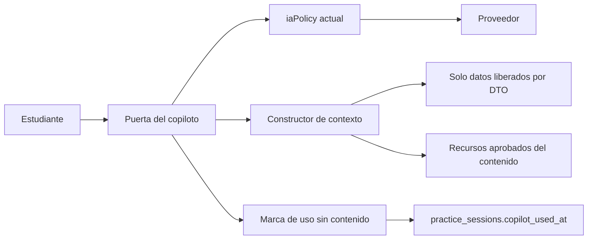

# 07. Copiloto conversacional

**Estado:** §1–§3 EXISTE EN CÓDIGO, por lectura de esta rama. **No ejecutado ni probado con el proveedor.** No hay validación pedagógica. No es un motor de recomendación. No se modifica en esta etapa.

## 1. Qué hace

Chat de ayuda escolar en `/academic-copilot`, enlazado como «Tutor virtual» en `VorticeInicio.tsx`.

| Pieza | Función |
|---|---|
| `POST /api/academic-copilot/chat` (`server/routes.ts`) | Exige sesión, limita frecuencia, calcula evaluaciones abiertas y llama al proveedor |
| `shared/iaPolicy.ts` | Política pura: límites, saneo, riesgo, prompt, bloqueo. Con prueba `script/iaPolicy.check.ts` |
| `server/geminiChat.ts` | Llama a `gemini-2.5-flash`. No persiste ni registra contenido |
| `client/src/pages/AcademicCopilot.tsx` | Interfaz. Envía `message` y `conversationHistory` |

## 2. Información

| Recibe | Detalle |
|---|---|
| Del cliente | Mensaje (máx. 1500), historial (8 turnos) y `evaluationId` opcional |
| Del servidor | Nivel del perfil, para el tono; preguntas de evaluaciones abiertas, para bloqueo local |
| Al proveedor | Prompt del sistema, mensaje saneado e historial saneado. **Sin** nombre, correo o ids agregados por el servidor |

**No recibe** estado de conocimiento, evidencias, puntajes, módulo actual ni recursos. Su historial vive en el navegador.

## 3. Restricciones existentes

- Modo tutor: no entrega respuestas finales; pistas graduales.
- Quita correo, RUT, teléfono y UUID. **No** detecta nombres propios.
- 20 mensajes por 10 minutos, en memoria **por instancia** (no global).
- Riesgo (autolesión, abuso, violencia): respuesta fija con contactos, sin llamar al proveedor. Son palabras clave, no un clasificador, y **no avisa a ningún adulto**.
- Bloquea mensajes que coinciden al 60 % con preguntas de evaluaciones abiertas.

## 4. Hallazgos

| Hallazgo | Consecuencia |
|---|---|
| El cliente no envía `evaluationId`, así que el «modo estricto» del prompt no se activa en este flujo | La protección queda en el bloqueo textual |
| El bloqueo textual se evade parafraseando | Riesgo de ayuda en evaluación. Límite conocido |
| Sin control de evaluación tras la ventana (P0-E inexistente) | El código ya bloquea de más, hasta aprobar |
| Sin verificación de calidad matemática | Respuesta errada posible |
| Datos de menores enviados a un proveedor externo | Revisión legal: [08](08_SEGURIDAD_Y_GOBIERNO.md) |
| Conviven `gemini_copilots` (enlaces externos) y `salesChatRoutes` | No confundir: no son este copiloto |
| Comentario de `Home.tsx` menciona otro servicio (`AiTutorService`) que no está en `server/` | Demo de la landing, no evidencia de función real |

## 5. Lo que le falta para el modelo de conocimiento

Contexto del contenido en curso; lista de recursos aprobados; marca `copiloto_en_sesion`; respeto por el embargo; evaluación pedagógica; métricas de calidad; política de aviso a adultos en riesgo; bloqueo robusto.

## 6. Arquitectura futura (PROPUESTA)

**Reglas:**
1. Contexto mínimo: nombre del contenido y definición. Sin identificadores, puntajes ni evidencia.
2. Si hay evaluación abierta de ese contenido: sin explicar ese contenido (decisión pendiente, N13, por el riesgo de sobre-bloquear práctica).
3. **Una sola vía:** el copiloto no escribe evidencia, estado, recomendaciones ni resultados.
4. No genera preguntas para estudiantes. Generar borradores: flujo editorial con revisión (K13).
5. Conversación: sin guardar, salvo decisión con revisión de datos.

**Requisitos antes de activarlo en el piloto:** evaluación con preguntas de prueba, revisada por docentes; pruebas adversas; definir qué ocurre en riesgo; revisión legal.
