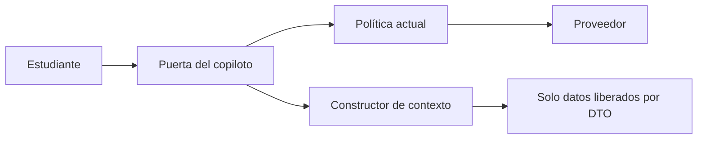

# 07. Copiloto conversacional

**Estado:** lo descrito EXISTE EN CÓDIGO, según lectura de esta rama. **No se ejecutó ni se probó con el proveedor.** Sin validación pedagógica. No se verificó si está activo en algún entorno: requiere `GEMINI_API_KEY`, no consultada. No se modifica en esta etapa.

**Decisión de diseño (PROPUESTO, orden de dirección):** el copiloto queda **fuera del primer piloto del motor**. El piloto funciona sin él. No hay contexto, API ni prompt nuevos.

## 1. Funciones

| Existe en código | Pieza |
|---|---|
| Chat en `/academic-copilot`, enlazado como «Tutor virtual» | `AcademicCopilot.tsx`, `VorticeInicio.tsx` |
| `POST /api/academic-copilot/chat`: sesión, límite de frecuencia, llamada al proveedor | `server/routes.ts` |
| Política pura, probada con `script/iaPolicy.check.ts` | `shared/iaPolicy.ts` |
| Llamada a `gemini-2.5-flash`, sin persistir ni registrar contenido | `server/geminiChat.ts` |
| Prompt de tutor por tramo: pistas, no respuestas finales | `buildSystemPrompt` |
| Quita correo, RUT, teléfono y UUID | `redactPII` |
| Respuesta fija ante palabras de riesgo | `detectRisk`, `riskResponse` |
| Bloqueo de preguntas de evaluaciones abiertas | `matchesEvaluationQuestion` |

| NO EXISTE |
|---|
| Conocimiento del estado, módulo o avance del estudiante |
| Selección de contenidos o recomendaciones; cambio de ruta |
| Escritura de evidencia, estado o resultados |
| Historial guardado o auditoría de conversaciones |
| Aviso a un adulto o a la institución ante riesgo |
| Evaluación de la exactitud de sus respuestas |
| Moderación de la salida del proveedor |

## 2. Información

| Recibe hoy | No recibe |
|---|---|
| Cliente: mensaje (hasta 1500), últimos 8 turnos, `evaluationId` opcional | Evidencias, estados, mapa |
| Servidor: nivel del perfil, para el tono | Puntajes, resultados, intentos |
| Servidor: texto de evaluaciones abiertas, **solo para comparar localmente** | Contenidos, recursos, módulo |
| **Al proveedor:** prompt, mensaje e historial saneados | Nombre, correo o id añadidos por el servidor |

El historial vive en el navegador y lo envía el cliente: **no es confiable**, aunque se sanea.

## 3. Riesgos del bloqueo por similitud

`matchesEvaluationQuestion` bloquea si coincide ≥ 60 % de las palabras de contenido; ignora preguntas con menos de 3.

| Riesgo | Efecto |
|---|---|
| Paráfrasis, sinónimos, otro idioma, faltas de ortografía | No bloquea |
| Dividir la pregunta en varios mensajes | No bloquea |
| Matemática: números y símbolos; palabras de menos de 4 letras se ignoran | **Especialmente débil en el piloto** |
| Preguntas cortas | Sin protección |
| Pregunta legítima de estudio parecida | Bloqueo injusto |
| El cliente no envía `evaluationId` | El modo estricto del prompt no se activa en esta pantalla |
| Las evaluaciones aprobadas salen de la lista | C21 |
| Consulta en cada mensaje sobre todas las evaluaciones | Costo, comentado en el código |

Sirve de barrera básica, no de garantía de integridad.

## 4. Riesgos de enviar mensajes de menores a un proveedor

- Un menor puede escribir datos sensibles (salud, familia, nombres): `redactPII` no detecta nombres ni direcciones.
- Salen del control de Barkley hacia Google. **No se verificaron** términos contractuales, retención, uso para entrenamiento, ubicación ni tipo de cuenta.
- Consentimiento de familias y base legal: sin verificar ([08](08_SEGURIDAD_Y_GOBIERNO.md) §6).
- Respuestas erróneas o inadecuadas sin filtro de salida.

## 5. Límites de la detección de riesgo

- Lista de palabras clave en español, **no un clasificador**. El propio código lo indica.
- No detecta: lenguaje indirecto, errores de escritura, jerga, riesgo a lo largo de varios turnos.
- Falsos positivos: frases escolares.
- **Solo revisa el mensaje actual, y responde con contactos. Nadie se entera.** Al no guardar la conversación, no hay seguimiento.
- Los teléfonos escritos en el código no se verificaron en esta revisión.
- Política institucional de protección: sin definir.

Este punto es independiente del piloto, porque el copiloto ya está enlazado: C22.

## 6. Condiciones antes de conectarlo al modelo

Todas, con autorización expresa:

1. Piloto del motor evaluado sin copiloto.
2. Revisión legal y de proveedor completas.
3. Protocolo de riesgo institucional, con responsables.
4. Evaluación pedagógica con preguntas de prueba, revisada por docentes, incluida exactitud matemática.
5. Pruebas adversas de extracción de respuestas.
6. Resolución de C21 y N13.
7. Prueba de no interferencia ampliada: [08](08_SEGURIDAD_Y_GOBIERNO.md) §7.
8. Definición de cómo cuenta la ayuda (O3).

## 7. Arquitectura futura (solo referencia, NO autorizada)

Principio: **una sola vía**. El copiloto nunca escribe evidencia, estado, recomendaciones ni resultados, y no genera preguntas para estudiantes.
