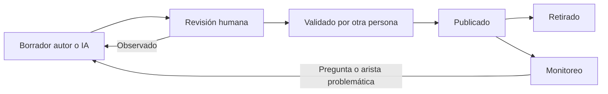

# 08. Seguridad, privacidad y gobierno pedagógico

**Estado:** PROPUESTO. Marcado cuando EXISTE EN CÓDIGO. Las invariantes 1–14 del diseño de máquina de estados P0-E siguen vigentes como propuesta; aquí se añaden las del conocimiento.

## 1. Filtración de pauta y resultados

| Vector | Control |
|---|---|
| Respuesta de API | DTO por lista blanca. EXISTE: `/submit` devuelve solo resultado; `toStudentQuestions` quita clave |
| Mapa y recomendación | Filtro único: §7.3 |
| Conteos, tiempos y orden | Prueba de no interferencia: §7 |
| Vistas de familia y tutor | Usan los mismos DTO, más la regla D4 |
| Notificaciones y exportes | Sin datos embargados |
| Copiloto | Fuera del piloto; recibe nada del modelo. Sigue C21 |
| Repaso existente | `server/repaso.ts` usa preguntas evaluativas (C11). Sin uso en el piloto |
| Clave en cliente | Nunca. Corrección solo en servidor |
| Comentario desactualizado en `shared/evaluations.ts`, y documento maestro §9 dice que `/submit` da puntaje | Código actual no lo hace. Corregir al implementar |

**Reloj:** siempre del servidor. T5 pendiente en Vercel.

## 2. Menores de edad

- Minimización: la evidencia guarda ids y hechos; sin texto libre, IP ni dispositivo.
- Preferir seudónimo en analítica. Grupos mínimos: EXISTE `MIN_GRUPO = 5` en `server/analitica.ts`.
- Nada de datos clínicos: no se infiere condición; `accommodation` indica apoyo usado, no diagnóstico.
- Sin perfilado comercial ni uso de datos de estudiantes para entrenar modelos externos: verificar términos del proveedor.
- Retención: O10. EXISTE: `learning_events` se purga a 12 meses. **Tensión:** evidencia solo de inserción frente a un plazo de borrado; requiere decisión y vía auditada.
- Sin datos reales en pruebas: solo cuentas `ficticio-*`, base aislada `brkl-preview`.

## 3. Permisos

| Dato | Estudiante | Familia | Tutor asignado | Revisor pedagógico | Admin |
|---|---|---|---|---|---|
| Mapa propio | Sí | D4, O7 | D4, O7 | Agregado | Sí, auditado |
| Evidencia detallada | Lo liberado | No | Lo liberado, D4 | Anónimo | Sí, auditado |
| Porcentaje de evaluación | Tras `review_at`, D1 | D4 | D4 | No | P9 |
| Pauta | Según P19 | No | Según P19 | Sí | Sí |
| Catálogo y grafo: editar | No | No | No | Sí | Sí |
| Publicar dominio | No | No | No | Validador ≠ autor | No por sí solo |
| Cambiar política | No | No | No | Propone | Dirección aprueba |

**Existe:** roles `admin`, `student`, `tutor`, `guardian` (`user_profiles`); `guardian_links` activo; `canViewReflection` por tutor asignado; `readerFor`, `hasActiveEnrollment`, `isAdmin` en servidor. **Falta:** rol de revisor pedagógico, y reglas por contenido. **Hallazgo:** `levelSubjectReader` permite lectura a admin o matriculado; las rutas nuevas requieren control por estudiante.

**Autorización siempre en servidor.** La autenticación de producción debe resolverse aparte; la sesión de pruebas de Preview no se usa fuera de `brkl-preview`.

## 4. Trazabilidad e inmutabilidad

- `knowledge_evidence`, `knowledge_state_events`, `evaluation_attempts` enviados y `governance_audit`: solo inserción, con trigger.
- Cada estado guarda: evidencia que lo gatilló, política y versión de dominio.
- **Sin cambios retroactivos.** Corregir una pregunta mal formulada: anulación como **nueva** fila `evidence_voids` (motivo, autor, aprobador distinto) que el cálculo aplica. **El resultado de una evaluación P0-E no se altera por esta vía**: una corrección de nota es otro proceso, sin definir (N12).
- Cambiar política o grafo: versión nueva y recálculo auditado, con eventos nuevos. Requiere decisión: ¿se recalcula a estudiantes activos? Recomendación: sí en piloto, con informe previo de cambios.

## 5. Gobierno pedagógico



| Elemento | Requisito | Quién (O4) |
|---|---|---|
| Contenido | Definición operacional y OA | Sin definir |
| Prerrequisito | Tipo, justificación y confianza | Sin definir |
| Pregunta | Alineación, claridad, clave, familia | Sin definir |
| Política | Aprobación de dirección | Dirección |

**Señales de monitoreo (sin metas):** pregunta casi siempre errada o acertada; arista con muchos estados no factibles; desacuerdo con evaluación docente.

## 6. Requiere revisión especializada

No se afirma que lo siguiente aplique; debe evaluarlo asesoría competente:

| Tema | Referencia a revisar |
|---|---|
| Datos personales y de menores | Ley 19.628 y su reforma (Ley 21.719); normativa sobre derechos de la niñez |
| Evaluación y promoción | Decreto 67/2018, Decreto Exento 2272/2007, reconocimiento oficial y reglamento interno (maestra §12; C15) |
| Transferencia a proveedores externos | Términos de Google y otros proveedores; consentimiento |
| Decisiones automatizadas | Derecho a revisión humana |
| Accesibilidad | P13 |
| Publicidad | Veracidad de textos publicados (C12) |

## 7. No interferencia de E2

**Estado:** protocolo PROPUESTO. **Nada ejecutado**: el núcleo P0-E y el motor no existen. Cuando se ejecute: solo en memoria o `brkl-preview`, con cuentas `ficticio-*`.

### 7.1 Propiedad y salvedad

**Mientras no se cumpla la condición de publicación ([03](03_MOTOR_DE_EVIDENCIAS.md) §8.3), ninguna salida puede depender de E2 más allá del estado permitido.** `review_at` es necesario, no suficiente.

**Salvedad (conflicto con una lectura literal, C20).** La regla APROBADA da «Aprobado» o «No aprobado» de inmediato, cerrando la instancia al aprobar. Por eso dos estudiantes con **distinto estado** no pueden tener salidas idénticas. Se necesitan dos pruebas:

| Prueba | A y B | Exigencia |
|---|---|---|
| **NI1: mismo estado** | Mismo estado, distinto puntaje y contenidos errados. Ejemplos: 70 y 95; 0 y 65 | **Salidas idénticas, byte a byte**, salvo identificadores normalizados |
| **NI2: distinto estado** | Uno aprobado, otro no | Solo difiere lo derivado del estado (lista abajo) |
| **NI3: control** | Mismo escenario, condición cumplida | Deben aparecer las diferencias. Si no, el filtro oculta de más o la prueba no mide |
| **NI4: versión abierta** | A cerró (aprobó, o su `review_at` pasó). C sigue con instancia abierta en **esa misma versión** | A no obtiene pauta, porcentaje, banda, contenidos ni cambio en mapa. Salidas de A iguales a un A′ con otras respuestas. Las salidas de C no cambian porque A cierre |
| **NI5: liberación** | Se registra la liberación | Antes: nada. Después: A publicable. Instancia nueva sobre esa versión: rechazada. Borrar liberación: rechazado |
| **NI6: copiloto** | Como P4, con proveedor simulado | Ningún dato de E2 ni pauta en la entrada. Bloqueo de esa versión aún activo para A (hoy NO: C21) |

NI1 es la prueba fuerte: detecta puntajes y contenidos. NI2 impide que el estado arrastre más información.

**Preparación:** dos cuentas ficticias con matrícula, nivel, recursos completados, evidencias liberadas, reloj simulado y orden de operaciones iguales. Se normalizan: ids propios, fecha de envío. Un cambio de semilla en permutaciones se fija.

### 7.2 Superficies comparadas

| Salida | Se compara | Estado en código hoy | Diferencia permitida en NI2 |
|---|---|---|---|
| Resultado de evaluación | Cuerpo y cabeceras de `/submit` y lecturas | EXISTE: responde `resultado` | `resultado`, intentos restantes, instancia cerrada |
| Mapa de conocimientos | DTO completo | NO EXISTE | **Ninguna** |
| Contenidos pendientes | Conteos y lista | NO EXISTE | **Ninguna** en el módulo evaluado |
| Recomendaciones | Lista, orden, motivo, `recommendation_log` | NO EXISTE | Solo contenidos del módulo siguiente, si se abrió |
| Orden de actividades | Ruta, `nextStep`, repaso | EXISTE: `buildOverview` usa `passed` | Derivado de aprobar |
| Notificaciones | Tipo, fecha, cuerpo | EXISTE: `moduloAbierto` depende de `passed` | `moduloAbierto` |
| Vistas familia y tutor | DTO por rol | EXISTE: `familia.ts` con «en revisión», sin puntaje | Estado, sujeto a D4 |
| Portafolio | Evidencias compartidas | EXISTE: expone `evaluationPassed` | Estado |
| Exportaciones | Cualquier archivo | NO EXISTE para estudiantes; verificado solo por búsqueda en `server` y páginas | **Ninguna** si se crea |
| Copiloto | **Entrada al proveedor simulado**, no su salida, y bloqueos | EXISTE; ver C21 | Bloqueos derivados del estado, según C21 |
| Canales laterales | Tamaño de respuesta, `ETag`, cabeceras de caché, códigos, número de consultas | | **Ninguna** en NI1. Latencia: medir, sin exigir igualdad |

**El copiloto no se compara por su texto:** el proveedor no es determinista, así que comparar respuestas daría falsos positivos. Se intercepta lo que se le enviaría.

**Es filtración:** cualquier diferencia en NI1; en NI2, cualquier diferencia fuera de la columna. Incluye porcentaje, banda, total de correctas, contenido errado, orden o tamaño alterados, y un mensaje que cite E2.

```text
prueba NI1:
  para cada superficie s, para cada rol r, en t antes de cumplirse la condición:
    assert normalizar(s(A, r, t)) == normalizar(s(B, r, t))
  cumplir la condición de publicación
  assert algún s difiere        # NI3
```

### 7.3 Filtro, cálculo y fallos

**Responsable único:** `server/conocimiento.ts` (PROPUESTO), función `evidenciaLiberada(db, estudiante, ahora)`. Es la única que lee `knowledge_evidence` para producir salidas, y excluye lo anulado.

**Aplicación en todas las consultas:**
1. Ningún otro archivo importa la tabla. Una prueba `script/*.check.ts` lo revisa con búsqueda de texto.
2. Toda salida pasa por DTO de lista blanca.
3. `ahora` lo fija el servidor, una vez por petición; nunca el cliente.
4. Excepción: el proceso de auditoría interna. Acceso de administrador según P9, registrado.
5. La proyección jamás incluye evidencia embargada. Puntajes en `evaluation_attempts` no se serializan: columnas excluidas por lista blanca.

**Cálculo al cumplirse la condición: en lectura, no por tarea.** Registrar la liberación de versión sí depende de N20.

```text
función leerEstado(estudiante, ahora):
  # fecha_efectiva = práctica: practice_released_at;
  #   evaluación: max(review_at, releases.released_at), con instancia cerrada
  pendientes = evidencias con computed_through < fecha_efectiva <= ahora
  si hay pendientes:
    en una transacción: recalcular contenidos afectados,
    insertar eventos (reason = liberacion, effective_at = fecha_efectiva),
    actualizar con condición computed_through sin cambios     # dos lecturas simultáneas
  retornar proyección
```

| Tema | Comportamiento |
|---|---|
| Datos desactualizados | La lectura se pone al día antes de responder. Respuestas personales con `Cache-Control: no-store`. El cliente no calcula estados |
| Recarga en pantalla | La siguiente lectura corrige. El cliente no conoce la fecha cierta |
| **Falla la tarea programada** | **No afecta el estado.** Solo se atrasan notificaciones y materialización. Reintento idempotente por `notification_log`. Una alerta si hay versiones sin liberar tras vencer todas sus instancias. Nunca se envía antes de la condición |
| Falla el cálculo en lectura | Responde error con reintento. **No** sirve datos sin liberar. No inventa un estado |
| Reloj | Margen desconocido entre instancias (T5). Una instancia adelantada podría publicar antes. Medir en E0 |
| Infraestructura | EXISTE: `/api/cron/notificaciones` con secreto, para cron externo. `vercel.json` no declara crons. No se verificó que haya un cron externo activo |

**Limitación:** la prueba cubre las superficies listadas. Toda salida nueva debe añadirse; se exige en revisión de código. No demuestra ausencia de canales de tiempo.
