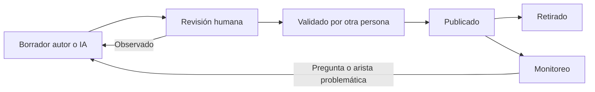

# 08. Seguridad, privacidad y gobierno pedagógico

**Estado:** PROPUESTO. Marcado cuando EXISTE EN CÓDIGO. Las invariantes 1–14 del diseño de máquina de estados P0-E siguen vigentes como propuesta; aquí se añaden las del conocimiento.

## 1. Filtración de pauta y resultados

| Vector | Control |
|---|---|
| Respuesta de API | DTO por lista blanca. EXISTE: `/submit` devuelve solo resultado; `toStudentQuestions` quita clave |
| Mapa y recomendación | Filtro único `released_at <= ahora`, en una sola función de repositorio. Prohibido consultar `knowledge_evidence` directo |
| Conteos, tiempos y orden | Prueba de no interferencia. Recomendación sin datos embargados |
| Vistas de familia y tutor | Usan los mismos DTO, más la regla D4 |
| Notificaciones y exportes | Sin datos embargados |
| Copiloto | Sin contexto embargado |
| Repaso existente | `server/repaso.ts` usa preguntas evaluativas (C11). Sin uso en el piloto |
| Clave en cliente | Nunca. Corrección solo en servidor |
| Comentario desactualizado en `shared/evaluations.ts`, y documento maestro §9 dice que `/submit` da puntaje | Código actual no lo hace. Corregir al implementar |

**Reloj:** siempre del servidor. T5 pendiente en Vercel.

## 2. Menores de edad

- Minimización: la evidencia guarda ids y hechos; sin texto libre, IP ni dispositivo.
- Preferir seudónimo en analítica. Grupos mínimos: EXISTE `MIN_GRUPO = 5` en `server/analitica.ts`.
- Nada de datos clínicos: no se infiere condición; `accommodation` indica apoyo usado, no diagnóstico.
- Sin perfilado comercial ni uso de datos de estudiantes para entrenar modelos externos: verificar términos del proveedor.
- Retención: O10. EXISTE: `learning_events` se purga a 12 meses. **Tensión:** evidencia solo de inserción frente a un plazo de borrado; requiere decisión y vía auditada.
- Sin datos reales en pruebas: solo cuentas `ficticio-*`, base aislada `brkl-preview`.

## 3. Permisos

| Dato | Estudiante | Familia | Tutor asignado | Revisor pedagógico | Admin |
|---|---|---|---|---|---|
| Mapa propio | Sí | D4, O7 | D4, O7 | Agregado | Sí, auditado |
| Evidencia detallada | Lo liberado | No | Lo liberado, D4 | Anónimo | Sí, auditado |
| Porcentaje de evaluación | Tras `review_at`, D1 | D4 | D4 | No | P9 |
| Pauta | Según P19 | No | Según P19 | Sí | Sí |
| Catálogo y grafo: editar | No | No | No | Sí | Sí |
| Publicar dominio | No | No | No | Validador ≠ autor | No por sí solo |
| Cambiar política | No | No | No | Propone | Dirección aprueba |

**Existe:** roles `admin`, `student`, `tutor`, `guardian` (`user_profiles`); `guardian_links` activo; `canViewReflection` por tutor asignado; `readerFor`, `hasActiveEnrollment`, `isAdmin` en servidor. **Falta:** rol de revisor pedagógico, y reglas por contenido. **Hallazgo:** `levelSubjectReader` permite lectura a admin o matriculado; las rutas nuevas requieren control por estudiante.

**Autorización siempre en servidor.** La autenticación de producción debe resolverse aparte; la sesión de pruebas de Preview no se usa fuera de `brkl-preview`.

## 4. Trazabilidad e inmutabilidad

- `knowledge_evidence`, `knowledge_state_events`, `evaluation_attempts` enviados y `governance_audit`: solo inserción, con trigger.
- Cada estado guarda: evidencia que lo gatilló, política y versión de dominio.
- **Sin cambios retroactivos.** Corregir una pregunta mal formulada: anulación como **nueva** fila `evidence_voids` (motivo, autor, aprobador distinto) que el cálculo aplica. **El resultado de una evaluación P0-E no se altera por esta vía**: una corrección de nota es otro proceso, sin definir (N12).
- Cambiar política o grafo: versión nueva y recálculo auditado, con eventos nuevos. Requiere decisión: ¿se recalcula a estudiantes activos? Recomendación: sí en piloto, con informe previo de cambios.

## 5. Gobierno pedagógico

| Elemento | Requisito | Quién (O4) |
|---|---|---|
| Contenido | Definición operacional y OA | Sin definir |
| Prerrequisito | Tipo, justificación y confianza | Sin definir |
| Pregunta | Alineación, claridad, clave, familia | Sin definir |
| Política | Aprobación de dirección | Dirección |

**Señales de monitoreo (sin metas):** pregunta casi siempre errada o acertada; arista con muchos estados no factibles; desacuerdo con evaluación docente.

## 6. Requiere revisión especializada

No se afirma que lo siguiente aplique; debe evaluarlo asesoría competente:

| Tema | Referencia a revisar |
|---|---|
| Datos personales y de menores | Ley 19.628 y su reforma (Ley 21.719); normativa sobre derechos de la niñez |
| Evaluación y promoción | Decreto 67/2018, Decreto Exento 2272/2007, reconocimiento oficial y reglamento interno (maestra §12; C15) |
| Transferencia a proveedores externos | Términos de Google y otros proveedores; consentimiento |
| Decisiones automatizadas | Derecho a revisión humana |
| Accesibilidad | P13 |
| Publicidad | Veracidad de textos publicados (C12) |
