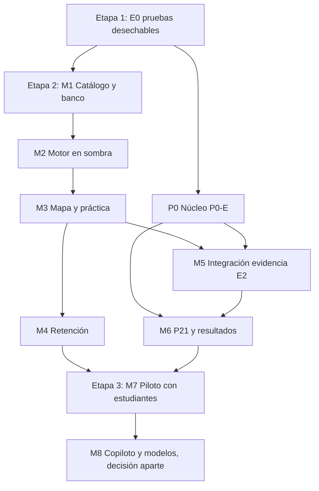

# 09. Plan de implementación

**Estado:** PROPUESTO. **No autoriza nada.** Cada etapa requiere autorización expresa, tras revisión independiente. Sin estimaciones de fecha: dependen de equipo y decisiones. Piloto: Matemática de 5.º Básico, unidad pendiente (O5). Flujo: rama, pruebas, Preview aislada con cuentas ficticias.

**Idea rectora.** La primera versión útil es **práctica + mapa**, sin tocar E2, sin P0-E y **sin copiloto**. Es medible, y su fallo no afecta resultados académicos. P0-E avanza en una vía paralela.

**Este plan no asume decisiones.** Cada etapa indica qué debe aprobarse antes. Sin esa aprobación, la etapa no comienza. Nada aquí está autorizado, incluida E0.

**Nombres.** Las etapas de construcción se llaman M1–M8 (antes E1–E8), porque «E2» se confundía con la evaluación E2. E0 se mantiene.

Si el sostenedor quiere empezar antes con estudiantes, M7 podría hacerse solo con M3 y M4, sin M5 ni M6. Sigue exigiendo todos los requisitos de la Etapa 3.

| Etapa | Objetivo | Componentes | Depende de | Cambios de datos | Riesgos | Pruebas | Aceptación | Dirección aprueba antes |
|---|---|---|---|---|---|---|---|---|
| **E0** | Demostrar soporte técnico | Pruebas D1–D9 en base desechable; T2 y T5 en Turso | | Ninguno en Vórtice | Conclusiones que obliguen a cambiar el diseño | [04](04_MODELO_DE_DATOS.md) §10 | Evidencia de cada prueba | Autorización expresa del sostenedor para ese entorno |
| **M1** | Catálogo y banco de la unidad | Herramienta admin; flujo editorial; revisor | E0 | Conocimiento y banco (aditivo) | Calidad, carga editorial | Publicación rechaza ciclos; FK de bancos; revisión obligatoria | Unidad publicada, validada por personas; banco suficiente | Unidad, validadores, migración |
| **M2** | Motor sin mostrar | Evidencia, política, estado, fronteras, log | M1 | Evidencia, estado, retención, log | Reglas erradas | §7 de [05](05_ALGORITMOS_Y_RECOMENDACIONES.md); datos ficticios | Determinista, reconstruible, auditado | Política de dominio, migración |
| **M3** | Práctica y mapa en Preview | Práctica, feedback, mapa, panel | M2 | Ninguno nuevo | Motivación, claridad, móvil | CA1–CA3, CA8, CA10; accesibilidad | Tres lentes separados; dato real | O6, diseño |
| **M4** | Retención | Agenda, comprobaciones | M3 | Ninguno nuevo | Carga | Intervalos con reloj simulado | Sin castigo por ausencia; agenda correcta | O8 |
| **P0** | Núcleo evaluativo | Instancias, intentos, ventanas, cierres, lotes, versiones | E0 | Migración P0-E | Concurrencia, histórico | T1–T5 reales; invariantes 1–14 | Según maestra | P7, P8, P16, P17, P20-v; migración |
| **M5** | E2 aporta evidencia | Respuestas por pregunta, embargo | M3, P0 | `evaluation_attempt_answers` | **Filtración** | **No interferencia**, CA4 | Payloads iguales hasta `review_at` | N2, C6, C7, N4 |
| **M6** | Resultados y P21 | Publicación, bandas, continuación | P0, M5 | `progression_continuations` | Normativo | CA4–CA7; límites 69,9/70/79,9/80 | E2 sigue «Reprobado» | **D1–D4, C14, C15**, Q1–Q3 |
| **M7** | Piloto real | Medición, acompañamiento | M3, M4 (M5, M6 si aplica) | Ninguno | Privacidad, equidad, muestra pequeña | Protocolo con docentes | Métricas aprobadas; informe | Datos, O10, revisión legal, autenticación real, despliegue |
| **M8** | Ampliar, solo si se autoriza | Copiloto ([07](07_COPILOTO_IA.md) §6); modelos | M7 con evidencia | Según diseño | Promesas sin evidencia | Validación fuera de muestra | Criterios fijados | N10, K3 |

**Medir en M7** (propuesta de lo que se mide, sin meta): concordancia con evaluación docente, aciertos diferidos, abandono, claridad, carga docente, y diferencias por dispositivo y conectividad. No minutos conectados.

**Plan de reversión:** cada migración es aditiva. Interruptor por dominio para ocultar mapa y práctica, sin afectar el resto de Vórtice.

**Calendario.** El acceso a la plataforma se anuncia para enero de 2027 (`Home.tsx`). No se verificó que este plan llegue a esa fecha: N15.

## Tres niveles de autorización

**Son independientes. Autorizar uno no autoriza el siguiente. Ninguno está autorizado hoy.**

| | **Etapa 1: E0** | **Etapa 2: piloto de contenidos y catálogo** | **Etapa 3: piloto con estudiantes reales** |
|---|---|---|---|
| Qué es | Pruebas técnicas | Unidad, contenidos, banco, validación pedagógica | Alumnos usando el sistema |
| Datos | Ficticios; base independiente y desechable | Contenido educativo; sin datos de estudiantes | Datos reales de menores |
| Personas | Equipo técnico; cuentas ficticias | Responsables académicos | Alumnos, familias, tutores |
| Producción | No | No | Decisión específica |
| Efecto académico | Ninguno | Ninguno | Sí |
| Autoriza | Sostenedor, expresamente | Sostenedor y responsables académicos | Sostenedor, tras todos los requisitos |
| Requiere | Solo esa autorización | O4, O5, N5, N9, K13; ficha de abajo | Ver lista |

**La orden del cierre documental no autoriza E0.** Etapa 2 es trabajo editorial: si necesita herramienta o tablas (M1), programarlas requiere autorización aparte. **Construir el motor (M2–M6) queda entre Etapa 2 y Etapa 3, y requiere su propia autorización de programación.**

**Requisitos de Etapa 3:**
- Protección de resultados y evaluaciones compartidas, con pruebas NI1–NI6 superadas y N20 decidido (si se usa E2).
- Integridad de evidencias: D1–D9 superadas.
- Autenticación y permisos reales. Según lo verificado en esta sesión, producción no tiene login configurado; no se volvió a comprobar.
- Revisión de textos públicos (C12).
- Copiloto: decisión de acceso y protocolo (C19, C22).
- Revisión legal (O10, C15 si aplica P21).
- Validación con responsables institucionales.

## Ficha de definición del piloto

**Plantilla para completar. No es catálogo: no contiene contenidos ni preguntas.** No se verificó qué materiales de 5.º Básico hay cargados: no se leyeron bases de datos. Aunque el nivel `5b` figura en código, eso no prueba que existan módulos o recursos.

| # | Información | Debe entregar | Debe aprobar | Requisito para aceptar |
|---|---|---|---|---|
| 1 | Unidad curricular (O5) | Equipo pedagógico | Dirección | Nombre, duración, módulos que cubre |
| 2 | OA oficiales | Equipo pedagógico | Validador | Código y texto de fuente oficial, año |
| 3 | Contenidos observables y evaluables | Equipo pedagógico | Validador distinto del autor | Definición operacional. Hipótesis: 30–60 contenidos |
| 4 | Prerrequisitos | Equipo pedagógico | Validador | Tipo, justificación, confianza. Solo necesaria y contributiva |
| 5 | Recursos disponibles | Equipo pedagógico | Validador | Lista real por contenido; vacíos señalados |
| 6 | Preguntas de práctica | Equipo pedagógico; borrador con IA solo si se autoriza | Revisor (K13) | Clave, explicación, contenido |
| 7 | Familias independientes (N9) | Equipo pedagógico | Validador | Mínimo por contenido, a decidir. K6 exige al menos 2; retención requiere más |
| 8 | Preguntas de evaluación, si corresponde | Equipo pedagógico | Validador | **No en la primera versión**, salvo decisión. Nunca del banco de práctica |
| 9 | Responsables (O4) | Dirección | Dirección | Nombres; autor y validador distintos; suplentes |
| 10 | Política de dominio (O1–O3, N16–N18) | Equipo pedagógico propone | Dirección | Sin parámetros nulos |
| 11 | Grupo de estudiantes, si hay piloto real | Dirección | Dirección y revisión legal | Consentimiento, criterio, tamaño |

### Reparto de tareas

| Equipo pedagógico | Equipo técnico |
|---|---|
| Elegir unidad, OA y contenidos | Herramienta de carga y flujo editorial |
| Escribir o revisar preguntas y asignar familias | Validar grafo: ciclos, referencias |
| Definir prerrequisitos | Informar faltantes: contenido sin familias, sin OA |
| Proponer criterios de dominio | Implementar política como parámetros |
| Revisar calidad con datos del monitoreo | Detector de similitud como aviso |
| Decidir qué mostrar a cada edad | Pruebas, seguridad y datos |

**El equipo técnico no define contenidos ni prerrequisitos. El pedagógico no edita datos fuera del flujo.** No se creó catálogo ni se cargaron preguntas.
