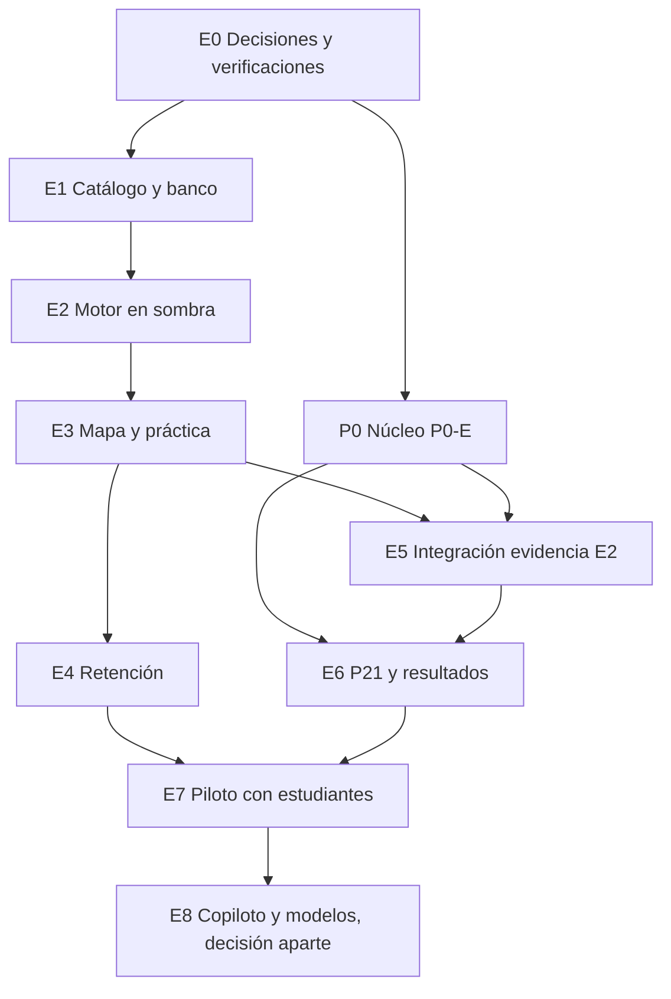

# 09. Plan de implementación

**Estado:** PROPUESTO. **No autoriza nada.** Cada etapa requiere autorización expresa, tras revisión independiente. Sin estimaciones de fecha: dependen de equipo y decisiones. Piloto: Matemática de 5.º Básico, unidad pendiente (O5). Flujo: rama, pruebas, Preview aislada con cuentas ficticias.

**Idea rectora.** La primera versión útil es **práctica + mapa**, sin tocar E2 ni depender de P0-E. Es medible, y su fallo no afecta resultados académicos. P0-E avanza en una vía paralela.

Si la dirección quiere empezar antes con estudiantes, E7 puede hacerse solo con E3 y E4, sin E5 ni E6.

| Etapa | Objetivo | Componentes | Depende de | Cambios de datos | Riesgos | Pruebas | Aceptación | Dirección aprueba antes |
|---|---|---|---|---|---|---|---|---|
| **E0** | Decidir y verificar | Lectura de esquema real; FK, triggers en base desechable; T2 en Turso | | Ninguno en Vórtice; base desechable autorizada | Deriva de esquema | Comparación sin escritura | Informe de deriva; soporte confirmado | O1–O5, N1, N2, N9, D3; autorizar base desechable |
| **E1** | Catálogo y banco de la unidad | Herramienta admin; flujo editorial; revisor | E0 | Conocimiento y banco (aditivo) | Calidad, carga editorial | Publicación rechaza ciclos; FK de bancos; revisión obligatoria | Unidad publicada, validada por personas; banco suficiente | Unidad, validadores, migración |
| **E2** | Motor sin mostrar | Evidencia, política, estado, fronteras, log | E1 | Evidencia, estado, retención, log | Reglas erradas | §7 de [05](05_ALGORITMOS_Y_RECOMENDACIONES.md); datos ficticios | Determinista, reconstruible, auditado | Política de dominio, migración |
| **E3** | Práctica y mapa en Preview | Práctica, feedback, mapa, panel | E2 | Ninguno nuevo | Motivación, claridad, móvil | CA1–CA3, CA8, CA10; accesibilidad | Tres lentes separados; dato real | O6, diseño |
| **E4** | Retención | Agenda, comprobaciones | E3 | Ninguno nuevo | Carga | Intervalos con reloj simulado | Sin castigo por ausencia; agenda correcta | O8 |
| **P0** | Núcleo evaluativo | Instancias, intentos, ventanas, cierres, lotes, versiones | E0 | Migración P0-E | Concurrencia, histórico | T1–T5 reales; invariantes 1–14 | Según maestra | P7, P8, P16, P17, P20-v; migración |
| **E5** | E2 aporta evidencia | Respuestas por pregunta, embargo | E3, P0 | `evaluation_attempt_answers` | **Filtración** | **No interferencia**, CA4 | Payloads iguales hasta `review_at` | N2, C6, C7, N4 |
| **E6** | Resultados y P21 | Publicación, bandas, continuación | P0, E5 | `progression_continuations` | Normativo | CA4–CA7; límites 69,9/70/79,9/80 | E2 sigue «Reprobado» | **D1–D4, C14, C15**, Q1–Q3 |
| **E7** | Piloto real | Medición, acompañamiento | E3, E4 (E5, E6 si aplica) | Ninguno | Privacidad, equidad, muestra pequeña | Protocolo con docentes | Métricas aprobadas; informe | Datos, O10, revisión legal, autenticación real, despliegue |
| **E8** | Ampliar | Copiloto; modelos | E7 con evidencia | Según diseño | Promesas sin evidencia | Validación fuera de muestra | Criterios fijados | N10, K3 |

**Medir en E7** (propuesta de lo que se mide, sin meta): concordancia con evaluación docente, aciertos diferidos, abandono, claridad, carga docente, y diferencias por dispositivo y conectividad. No minutos conectados.

**Plan de reversión:** cada migración es aditiva. Interruptor por dominio para ocultar mapa y práctica, sin afectar el resto de Vórtice.

**Calendario.** El acceso a la plataforma se anuncia para enero de 2027 (`Home.tsx`). No se verificó que este plan llegue a esa fecha: N15.
