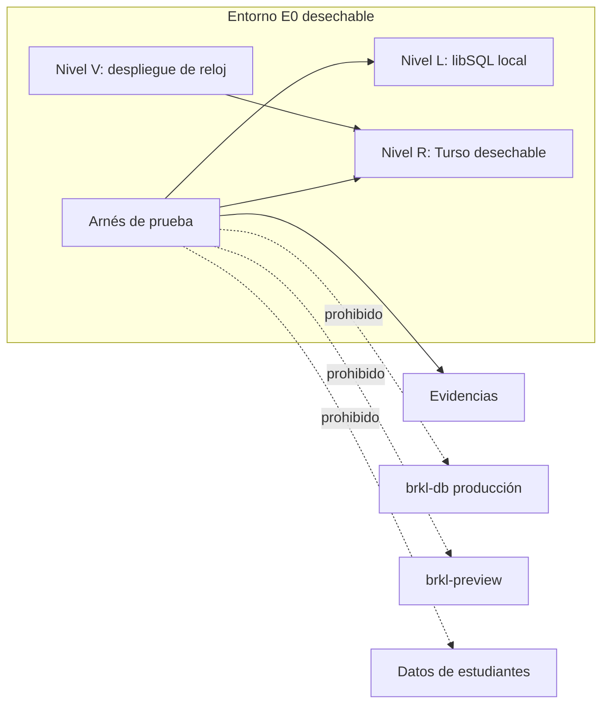
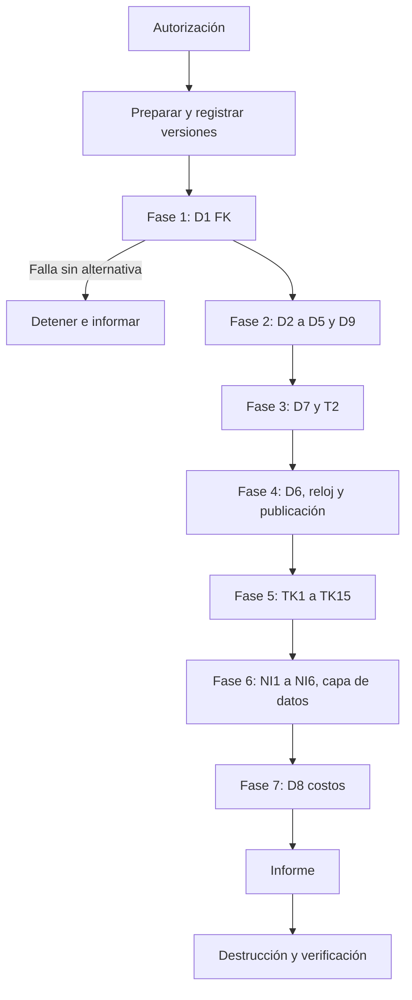

# 11. Plan técnico de E0

**Estado:** PROPUESTO. **E0 no está autorizada. No se creó ninguna base ni se ejecutó ninguna prueba.** Etapa 1 de [09](09_PLAN_DE_IMPLEMENTACION.md). Los comandos son referencia: su sintaxis exacta se confirma al ejecutar.

## 1. Objetivo y límites

E0 responde una pregunta: **¿la plataforma técnica sostiene las garantías del diseño?** Sus resultados pueden obligar a cambiarlo.

**No hace:** construir el motor, tocar el esquema de Vórtice, cargar contenidos reales, ni aprobar decisiones pedagógicas.

**Salvedad que requiere autorización (A3).** Hoy no existe nada que probar más allá del motor de base de datos: ni núcleo P0-E, ni filtro, ni `evaluar`. Por eso E0 necesita un **arnés de prueba**: scripts, esquema de prueba y una implementación de referencia mínima. Es código de prueba, no de la aplicación, y nunca se importa desde `server/`, `client/` ni `shared/`.

| Grupo | Alcance real en E0 | Queda para después |
|---|---|---|
| D1–D9 | **Completo**, sobre el esquema de prueba | Repetir sobre la migración real |
| TK1–TK15 | **Completo**, sobre `evaluar` de referencia | Repetir sobre la función real |
| NI1–NI6 | **Solo capa de datos**: filtro de referencia y salidas simuladas. Más inventario de superficies existentes | **Prueba de superficies reales**, en M5 y M6. E0 no puede demostrarla |

**Superar E0 no demuestra que Vórtice no filtre.** Demuestra que el mecanismo es viable.

## 2. Arquitectura y aislamiento



| Nivel | Qué es | Para qué | Costo y permiso |
|---|---|---|---|
| **L** | `turso dev` con archivo en carpeta temporal, como `script/p0e-t15.ts` | Todo lo posible, primero | Local |
| **R** | Base nueva en Turso, en un **grupo propio**, con varias ubicaciones si el plan lo permite | Lo que L no demuestra: conexión remota, réplicas, concurrencia | Requiere A1. Plan y cupos sin verificar |
| **V** | Función mínima en un **proyecto Vercel separado**, nunca `brkl` | Reloj entre instancias (T5) | Requiere A2. Opcional |

**Barreras de aislamiento:**
1. **Lista blanca:** el arnés rechaza cualquier URL que no sea `127.0.0.1`, `localhost` o el host exacto `brkl-e0-*`. Rechaza expresamente `brkl-db` y `brkl-preview`.
2. **Sentinela:** antes de escribir, exige una tabla `e0_sentinel` con el id de la corrida. Sin ella, se detiene. Las bases reales no la tienen.
3. **Credenciales:** token solo de esa base, con vencimiento corto, en variables de sesión de `E0_*`. No se lee `.env.local`, `.env` ni variables de Vercel. El arnés se detiene si existe `TURSO_DATABASE_URL` en el entorno.
4. **`NODE_ENV=production`:** se detiene, como `pagos.check.ts`.
5. **Sin red saliente** salvo al host permitido. Sin Resend ni Gemini: el copiloto se simula.
6. **Fuera de `check:vortice`:** los archivos no llevan sufijo `.check.ts`.
7. **Secretos:** nunca en evidencias.

## 3. Requisitos previos

| Requisito | Responsable | Estado |
|---|---|---|
| Autorizaciones A1–A5 (§10) | Sostenedor | PENDIENTE |
| Commit del diseño congelado para la corrida | Técnico | Se registra al iniciar |
| Rama aparte para el arnés, sin merge | Técnico | Requiere A3 |
| Versiones fijadas: `@libsql/client` y `drizzle-orm` del `package.json`; `turso`, Node, `sqld` | Técnico | Se registran |
| Cupo de Turso para otra base y grupo | Técnico | Sin verificar |

**Creación (referencia, solo con A1):**

```text
turso group create brkl-e0
turso db create brkl-e0-<AAAAMMDD> --group brkl-e0
turso db tokens create brkl-e0-<AAAAMMDD> --expiration 1d
```

## 4. Datos y cuentas

**Solo ficticios, generados por una semilla fija y guardada:** estudiantes `ficticio-e0-NNN`, correos `@ejemplo.invalid`, contenidos `HIP-*`, preguntas sin contenido curricular real. Sin copiar nada de ninguna base. Antes de cada corrida, un escaneo rechaza RUT, correos válidos o nombres que no sigan el patrón.

## 5. Procedimiento

Orden fijo. **Si falla una prueba de la fase 1, se detiene:** lo demás no tendría sentido.



### 5.1 D1–D9

Definición: [04](04_MODELO_DE_DATOS.md) §10. Cómo se ejecuta:

| Prueba | Nivel | Procedimiento | Repeticiones | Aprueba | Rechaza |
|---|---|---|---|---|---|
| D1 | L, R | Por cada modo (`createClient` local, HTTP, `batch`, transacción interactiva, conexión nueva): `PRAGMA foreign_keys`, activarlo si hace falta, volver a leer, insertar huérfano | 1 por modo | `1` y rechazo en **todos** | Algún modo acepta el huérfano. Alternativas: triggers o validación en aplicación, y revisar el diseño |
| D2 | L, R | Inválidos 1–5, 18; nulos por origen; versión nueva de pregunta y dominio | 1 | Exactamente lo esperado | Un inválido entra, o un válido se rechaza |
| D3 | Sin base | Esquema en Drizzle; `drizzle-kit generate`; comparar con [04](04_MODELO_DE_DATOS.md) §6 | 1 | Restricciones presentes o suplidas por SQL propio documentado | Pérdida silenciosa de una restricción |
| D4 | L, R | Aplicar triggers; repetir `push` y `generate`; `UPDATE`/`DELETE`. Deriva real: solo si A4 | 1 | Triggers intactos y escritura rechazada | Herramienta los elimina sin aviso |
| D5 | L, R | Inválidos 1–18 y válidos | 1 | 18 rechazos con la causa correcta | Cualquier otro |
| D6 | L | §5.3 | 1 por caso | Publica solo con la condición completa | Publicación antes de tiempo |
| D7 | L, R | §5.2 | 50 (como T1–T5) | 50/50 | Una sola escritura parcial o duplicada |
| D8 | L, R | Volumen simulado: hipótesis de 60 estudiantes, 60 contenidos y 10 000 evidencias | 3 | **Sin umbral aprobado:** se entregan cifras | No aplica; informa |
| D9 | L | Reconstruir y comparar tras cada escenario TK, anulación y liberación; forzar fallo y reconciliar | Todos | Sin diferencias | Una diferencia |

### 5.2 libSQL, Turso, Drizzle, transacciones y concurrencia

| Comprobación | Procedimiento | Evidencia |
|---|---|---|
| FK en conexiones sin estado | ¿Persiste el `PRAGMA` entre peticiones HTTP? ¿Por conexión o por base? | Salida por modo |
| Drizzle | `db.batch` y `db.transaction`; ¿qué SQL emite?; FK compuesta y CHECK | SQL capturado |
| Atomicidad | Respuesta + evidencia + evento + proyección, con fallo forzado en cada posición | Conteos antes y después |
| Envíos simultáneos | Mismo `client_submission_id` ×20 | 1 respuesta, 1 evidencia |
| `sequence_no` | 20 inserciones simultáneas de un estudiante | Sin duplicados; reintentos contados |
| Dos lecturas al día | 10 `leerEstado` simultáneos con evidencia recién publicable | 1 evento por cambio; proyección correcta |
| Réplicas | Escribir y leer en otra ubicación; **¿se lee un estado viejo?** | Tiempo y casos de lectura vieja |
| Cierre compartido | Liberación frente a asignación de instancia simultáneas | Una gana; nunca instancia sobre versión liberada |
| Repetir T2 | `p0e-t15.ts` limita a hosts locales: en R se usa una copia en el arnés. **No se modifica ese script** | Salida |

Si hay lectura vieja en réplicas: **hallazgo crítico**, porque podría servir datos antiguos. Exige leer en primaria.

### 5.3 Reloj y publicación

Reloj inyectado en el arnés. Casos, con A y C en una versión compartida:

| # | Situación | Esperado |
|---|---|---|
| 1 | Antes de `review_at`, sin liberación | No publicable |
| 2 | `review_at` pasado, C abierta | **No publicable** |
| 3 | A aprobada hace días, C abierta | No publicable |
| 4 | Liberación registrada, `review_at` futuro | No publicable |
| 5 | Ambos cumplidos, instancia cerrada | Publicable, fecha efectiva correcta |
| 6 | Instancia nueva sobre versión liberada | Rechazada |
| 7 | Borrar o duplicar liberación | Rechazado |
| 8 | Cambio de horario (fechas de T4) | Coherente con P3 |
| 9 | Ampliación dentro de la extensión | Se documenta el efecto en `review_at` copiado |
| 10 | Salto de reloj de una instancia ±N s | Se cuantifica: margen de publicación anticipada |

El mecanismo que registra la liberación es N20, **sin decidir**: el arnés inserta la fila directamente y prueba solo sus efectos.

**Reloj real (T5, nivel V):** varias invocaciones comparan su reloj con el de la base. Se informa desfase máximo. Sin umbral aprobado.

### 5.4 TK1–TK15

Definición: [03](03_MOTOR_DE_EVIDENCIAS.md) §9.2. Solo memoria, sin base.

- `evaluar` de referencia, según [05](05_ALGORITMOS_Y_RECOMENDACIONES.md) §2.
- Matriz de políticas: `k6_separation` ∈ {ninguna, sesion, dia}, y alternativas de O1, O3, N16, N17, N18. **Probar una alternativa no la aprueba.**
- Agrega prueba de determinismo: misma entrada, misma salida, 100 veces con orden de filas barajado.
- **Aprueba:** todos los resultados esperados, por política. **Rechaza:** cualquier diferencia; se decide si falla la regla o la implementación de referencia.

### 5.5 NI1–NI6

Definición: [08](08_SEGURIDAD_Y_GOBIERNO.md) §7. **Alcance E0:** capa de datos.

| Prueba | En E0 | Aprueba | Rechaza |
|---|---|---|---|
| NI1 | Dos estudiantes, mismo estado, distintas respuestas; comparar salida del filtro y DTO simulados de mapa, pendientes, recomendaciones | Idénticos byte a byte | Una diferencia |
| NI2 | Estado distinto | Solo lista permitida | Otra diferencia |
| NI3 | Cumplida la condición | Las diferencias aparecen | No aparecen: la prueba no mide |
| NI4 | A cerrada, C abierta, reloj tras `review_at` | A igual a A′; C sin cambios | Cualquier dato |
| NI5 | Antes y después de liberar | Correcto e irreversible | Reversible o anticipado |
| NI6 | Constructor de entrada simulado para proveedor simulado | Sin datos de E2 | Algún dato |

**Por lectura, además:** inventario de superficies reales ([08](08_SEGURIDAD_Y_GOBIERNO.md) §7.2) con su estado. Se conoce que el copiloto hoy no cumple NI6 en su bloqueo (C21), y que las superficies existentes no son de la capa nueva. **Esto no se corrige en E0.**

**Control de eficacia:** se introduce a propósito un error en la **copia de referencia** (filtro desactivado). NI1 debe fallar; si no falla, la prueba no sirve.

## 6. Evidencias

Carpeta por corrida, fuera del código de la aplicación, sin secretos. Tras revisión se publica en `docs/vortice/e0/<corrida>/` (no se crea ahora).

| Evidencia | Contenido |
|---|---|
| `manifest.json` | Commit, versiones, fecha, operador, semilla, nivel, host enmascarado |
| `autorizacion.md` | Texto y fecha de la autorización |
| `resultados/<id>.json` | Prueba, entrada, esperado, obtenido, repeticiones, veredicto |
| `sql/` | SQL aplicado y emitido, `sqlite_master` antes y después |
| `comandos.log` | Comandos con secretos enmascarados |
| `mediciones.csv` | D8, réplicas, reloj |
| `ni/` | Salidas comparadas y sus diferencias |
| `destruccion.md` | §8 |
| `SHA256SUMS` | Huellas de todo |

**Veredictos:** `APROBADA`, `RECHAZADA`, `INCONCLUSA` (no se pudo ejecutar; nunca cuenta como aprobada), `INFORMATIVA` (sin umbral aprobado).

## 7. Criterios globales

| Resultado | Condición | Consecuencia |
|---|---|---|
| **E0 superada** | D1–D7, D9, TK y NI en `APROBADA`; D8 y reloj con cifras | Permite al sostenedor considerar el siguiente paso. **No autoriza nada** |
| **E0 con cambios** | Fallo con alternativa viable (por ejemplo, triggers por D1) | Se corrige el diseño, y se repite lo afectado |
| **E0 rechazada** | Fallo en integridad, atomicidad o embargo, sin alternativa | No se avanza; se revisa el modelo o la plataforma |
| **E0 incompleta** | Alguna `INCONCLUSA` en lo crítico | No se declara superada |

**Detener de inmediato:** señal de conexión a un host fuera de lista; un dato no ficticio; un secreto en evidencias. Se destruye, se informa y se revocan credenciales.

**Umbrales que el sostenedor puede querer fijar** (D8, desfase de reloj): sin ellos, son informativos.

## 8. Destrucción y verificación

```text
turso db tokens invalidate brkl-e0-<AAAAMMDD>
turso db destroy brkl-e0-<AAAAMMDD> --yes
turso group destroy brkl-e0 --yes
```

Más: borrar archivos `turso dev`, proyecto Vercel de V y variables `E0_*`.

| Comprobación | Método, sin conectar a bases reales | Esperado |
|---|---|---|
| Base eliminada | `turso db list` antes y después | Solo falta la de E0 |
| Credenciales | Reintentar con el token | Rechazado |
| Bases reales | `turso db list`: nombres y existencia. **No se abren** | Sin cambios |
| Vercel `brkl` | `vercel ls` y `vercel env ls`, solo nombres | Sin despliegues ni variables nuevas por E0 |
| Repositorio | `git status` y `git diff` en `vortice/integracion`, `main` sin cambios | Solo documentos autorizados |
| Código | Búsqueda: nada de `server/`, `client/`, `shared/` importa el arnés | Ninguna coincidencia |
| Registro | `comandos.log`: solo hosts permitidos | Sin otros hosts |
| Correos e IA | Sin credenciales cargadas, ni Resend ni Gemini | Ningún envío |

**Límite:** esto no inspecciona el interior de las bases reales, porque hacerlo exigiría abrirlas. La garantía viene de que el arnés nunca tuvo sus credenciales.

## 9. Dependencias y riesgos

| Riesgo | Efecto | Mitigación |
|---|---|---|
| Conexión errada a una base real | **Grave** | Barreras de §2 |
| D1 falla en HTTP | Diseño de FK no sirve | Triggers o validación; repetir D2 y D5 |
| Implementación de referencia difiere de la futura | Falsa confianza | Repetir en M2, M5 y M6 |
| Arnés con errores | Falsos resultados | Controles de eficacia |
| Cupos de Turso o Vercel | Nivel R o V incompleto | `INCONCLUSA` |
| Costo de cuentas | Sin verificar | Revisar antes de A1 |
| Réplicas con lectura vieja | Publicación inconsistente | Hallazgo; leer de primaria |
| Decisiones abiertas (O1, O2, N20) | No se prueba una regla final | Matriz de políticas |
| Prueba tomada como aprobación del motor | Confusión | Este documento, §1 y §7 |

## 10. Autorizaciones que requiere el sostenedor

Independientes. Ninguna otorgada.

| ID | Autorización | Necesaria para |
|---|---|---|
| **A1** | Crear y destruir una base desechable en la cuenta de Turso, con su costo | Nivel R |
| **A2** | Proyecto Vercel separado de prueba | Nivel V (opcional) |
| **A3** | Escribir el arnés en una rama aparte, sin merge | **Toda E0.** Es escribir código, aunque no de la aplicación |
| **A4** | Comparar el esquema real, solo lectura de estructura | Deriva en D4 (opcional). Toca bases reales: **puede omitirse**, con esa parte `INCONCLUSA` |
| **A5** | Publicar evidencias en el repositorio | §6 |
| A6 | Fijar umbrales de D8 y reloj, si los desea | Pasar de informativo a aprobado o rechazado |

**E0 mínima:** A3, solo con nivel L. Barata y sin nube, pero **no demuestra Turso ni réplicas**: D1, D4 y D7 quedan `INCONCLUSA` en R, y E0 no se daría por superada.
