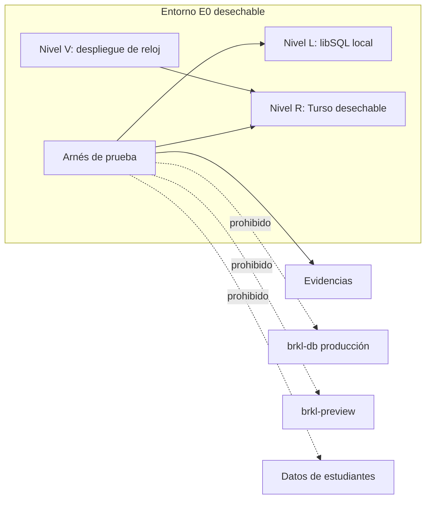
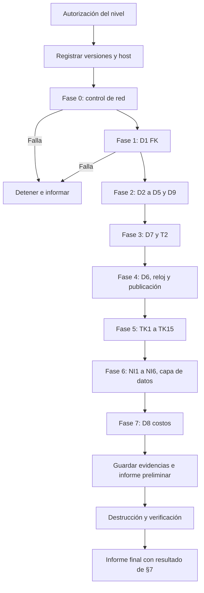

# 11. Plan técnico de E0

**Estado:** PROPUESTO. **E0 no está autorizada. No se creó ninguna base ni se ejecutó ninguna prueba.** Etapa 1 de [09](09_PLAN_DE_IMPLEMENTACION.md). Los comandos son referencia: su sintaxis exacta se confirma al ejecutar.

## 1. Objetivo y límites

E0 responde una pregunta: **¿la plataforma técnica sostiene las garantías del diseño?** Sus resultados pueden obligar a cambiarlo.

**No hace:** construir el motor, tocar el esquema de Vórtice, cargar contenidos reales, ni aprobar decisiones pedagógicas.

**Salvedad que requiere autorización (A3).** Hoy no existe nada que probar más allá del motor de base de datos: ni núcleo P0-E, ni filtro, ni `evaluar`. Por eso E0 necesita un **arnés de prueba**: scripts, esquema de prueba y una implementación de referencia mínima. Es código de prueba, no de la aplicación, y nunca se importa desde `server/`, `client/` ni `shared/`.

| Grupo | Alcance real en E0 | Queda para después |
|---|---|---|
| D1–D9 | **Completo**, sobre el esquema de prueba | Repetir sobre la migración real |
| TK1–TK15 | **Completo**, sobre `evaluar` de referencia | Repetir sobre la función real |
| NI1–NI6 | **Solo capa de datos**: filtro de referencia y salidas simuladas. Más inventario de superficies existentes | **Prueba de superficies reales**, en M5 y M6. E0 no puede demostrarla |

**Superar E0 no demuestra que Vórtice no filtre.** Demuestra que el mecanismo es viable.

**Una corrida local no es E0.** Es un resultado parcial del nivel L, y no permite declarar E0 superada: ver §7.

## 2. Arquitectura y aislamiento



| Nivel | Qué es | Para qué | Costo y permiso |
|---|---|---|---|
| **L** | `turso dev` con archivo en carpeta temporal, como `script/p0e-t15.ts` | Todo lo posible, primero | Local |
| **R** | Base nueva en Turso, en un **grupo propio**, con varias ubicaciones si el plan lo permite | Lo que L no demuestra: conexión remota, réplicas, concurrencia | Requiere A3 y A1. Plan y cupos sin verificar |
| **V** | Función mínima en un **proyecto Vercel separado**, nunca `brkl` | Reloj entre instancias (T5) | Requiere A3, A1 y A2. Sin V, E0 no se da por superada (§7) |

**Barreras de aislamiento:**
1. **Host exacto:** ver §2.1. Sin comodines ni coincidencias parciales.
2. **Sentinela:** antes de escribir, exige una tabla `e0_sentinel` con el id de la corrida. Sin ella, se detiene. Las bases reales no la tienen.
3. **Credenciales:** token solo de esa base, con vencimiento corto, en variables de sesión de `E0_*`. No se lee `.env.local`, `.env` ni variables de Vercel. El arnés se detiene si existe `TURSO_DATABASE_URL` en el entorno.
4. **`NODE_ENV=production`:** se detiene, como `pagos.check.ts`.
5. **Control de red:** ver §2.2. Sin credenciales de Resend ni Gemini; el copiloto se simula.
6. **Fuera de `check:vortice`:** los archivos no llevan sufijo `.check.ts`.
7. **Secretos:** nunca en evidencias.

### 2.1 Validación del host

**Un patrón como `brkl-e0-*` no sirve:** también coincidiría con otra base. El hostname real de Turso no se conoce hasta crear la base, así que la autorización tiene dos pasos:

1. A1 autoriza crear una base con un nombre concreto y solo ese.
2. El operador crea la base, obtiene su URL y la anota en `autorizacion.md`. **Antes de la primera conexión**, el sostenedor o quien designe confirma ese hostname exacto por escrito.

| Regla | Definición |
|---|---|
| Valor permitido | Una constante `E0_ALLOWED_HOST`, con un hostname completo, de esa corrida |
| Comparación | `new URL(url).hostname === E0_ALLOWED_HOST`, igualdad exacta tras normalizar a minúsculas. Sin sufijos, prefijos, comodines ni expresiones regulares |
| Protocolo | Solo los esperados para esa base. Se rechazan credenciales o puerto en la URL no previstos |
| Nivel L | Solo `127.0.0.1` y el puerto de esa corrida. `localhost` se excluye porque depende de la resolución local |
| Réplicas | Si probarlas exige otra URL, cada hostname se autoriza igual, uno por uno. Si no, se documenta cómo se comprobó la ubicación servida |
| Otra corrida | Hostname nuevo y confirmación nueva |
| Rechazo adicional | Si el valor contiene `brkl-db` o `brkl-preview`, se detiene aunque esté mal configurado |

**Alcance:** esta validación solo limita a qué URL conecta el cliente del arnés. **No es un bloqueo de red.**

### 2.2 Control de red

**Una validación dentro del arnés no bloquea la red:** una dependencia, un error o un proceso externo podrían conectarse igual. El bloqueo debe estar fuera del proceso.

| Nivel | Mecanismo propuesto | Qué impide | Límite |
|---|---|---|---|
| **L y TK** | Contenedor sin red externa (por ejemplo `--network none`), con el arnés y `sqld` dentro, comunicados por `127.0.0.1` | Toda salida | Docker u otro equivalente sin verificar en el equipo. Dependencias instaladas antes, desde el archivo de bloqueo |
| **R** | Contenedor en red interna sin ruta a Internet, cuya única salida es un **proxy de salida con lista de un hostname exacto** (`CONNECT` y SNI) | Salidas directas y a otros hosts | **Riesgo técnico:** el cliente `fetch` de Node no usa proxy de forma automática; debe configurarse y demostrarse en nivel L. Firewall por IP no sirve bien: las IP de Turso pueden cambiar |
| **V** | **Sin bloqueo de red disponible para nosotros** | Nada a nivel de red | Control solo por contenido: función mínima, sin dependencias, revisada, y sin más credenciales que las de E0. Riesgo residual declarado |

**Además, en R y L:**
- El contenedor monta solo la carpeta del arnés, **no la raíz del repositorio**: `.env.local` no queda a su alcance.
- Sesión de la CLI de Turso **fuera del contenedor**. Esa sesión sí tiene alcance sobre toda la organización: crear y destruir son comandos manuales, registrados, y nunca los ejecuta el arnés.

**Prueba previa obligatoria (control negativo):** desde el contenedor, una conexión a un destino no permitido debe fallar a nivel de red, sin pasar por la validación del arnés. No se usan hosts reales del proyecto como destino de prueba. Se conserva la salida.

**Si no se puede implementar el bloqueo en R, el nivel R no comienza**, salvo que el sostenedor acepte por escrito ese riesgo residual. En ese caso, el informe debe decir que no hubo bloqueo de red. La protección principal seguiría siendo que el entorno no contiene credenciales reales.

## 3. Requisitos por nivel

**Fuente única de autorizaciones: §10. Ninguna otorgada.**

| Requisito | L: local | R: Turso | V: Vercel | Publicar evidencias |
|---|---|---|---|---|
| A3, arnés en rama aparte | **Sí** | **Sí** | **Sí** | No |
| A1, base desechable con costo y lecturas de nombres | No | **Sí** | **Sí** (mide contra R) | No |
| Confirmación de hostname exacto (§2.1) | No | **Sí** | **Sí** | No |
| A2, proyecto Vercel y lecturas de nombres | No | No | **Sí** | No |
| A5 | No | No | No | **Sí** |
| A4 | No | No | No | No: operación aparte (§10) |
| A6 | No | No | No | No: solo cambia veredictos |
| Control de red (§2.2) | Contenedor | Proxy demostrado, o riesgo aceptado | No disponible | No |
| Cupo y costo verificados | No | Sí | Sí | No |
| Commit del diseño y versiones registradas (`@libsql/client`, `drizzle-orm`, `turso`, Node, `sqld`) | Sí | Sí | Sí | No |

**Sin A5, las evidencias se conservan fuera del repositorio** y se entregan al sostenedor.

**Creación (referencia, nivel R, solo con A1):**

```text
turso group create brkl-e0
turso db create brkl-e0-<AAAAMMDD> --group brkl-e0
turso db show brkl-e0-<AAAAMMDD> --url
turso db tokens create brkl-e0-<AAAAMMDD> --expiration 1d
```

## 4. Datos y cuentas

**Solo ficticios, generados por una semilla fija y guardada:** estudiantes `ficticio-e0-NNN`, correos `@ejemplo.invalid`, contenidos `HIP-*`, preguntas sin contenido curricular real. Sin copiar nada de ninguna base. Antes de cada corrida, un escaneo rechaza RUT, correos válidos o nombres que no sigan el patrón.

## 5. Procedimiento

Orden fijo: las fases se recorren primero en L. R y V solo empiezan si están autorizadas. **Si D1 falla sin alternativa, se detiene.** Si hay alternativa, se detiene igual, se corrige el diseño y se reinicia desde la fase 1 (§7).

| Fase | Pruebas | L | R | V |
|---|---|---|---|---|
| 0 | Control negativo de red (§2.2) y sentinela | Sí | Sí | Revisión de la función |
| 1 | D1 | Sí | Sí | |
| 2 | D2–D5, D9 | Sí (D3 sin base; D9 solo L) | D2, D4, D5 | |
| 3 | D7 y T2 | Sí | **Sí: es lo que importa** | |
| 4 | D6, reloj y publicación | Sí | Casos 5–7 de §5.3 y cierre compartido | T5 |
| 5 | TK1–TK15 | Sí (sin base) | | |
| 6 | NI1–NI6 | Sí | | |
| 7 | D8 | Sí | Sí | |



### 5.1 D1–D9

Definición: [04](04_MODELO_DE_DATOS.md) §10. Cómo se ejecuta:

| Prueba | Nivel | Procedimiento | Repeticiones | Aprueba | Rechaza |
|---|---|---|---|---|---|
| D1 | L, R | Por cada modo (`createClient` local, HTTP, `batch`, transacción interactiva, conexión nueva): `PRAGMA foreign_keys`, activarlo si hace falta, volver a leer, insertar huérfano | 1 por modo | `1` y rechazo en **todos** | Algún modo acepta el huérfano. Alternativas: triggers o validación en aplicación, y revisar el diseño |
| D2 | L, R | Inválidos 1–5, 18; nulos por origen; versión nueva de pregunta y dominio | 1 | Exactamente lo esperado | Un inválido entra, o un válido se rechaza |
| D3 | Sin base | Esquema en Drizzle; `drizzle-kit generate`; comparar con [04](04_MODELO_DE_DATOS.md) §6 | 1 | Restricciones presentes o suplidas por SQL propio documentado | Pérdida silenciosa de una restricción |
| D4 | L, R | Aplicar triggers; repetir `push` y `generate`; `UPDATE`/`DELETE`. **La deriva del esquema real no forma parte de esta prueba en E0** (§10, A4) | 1 | Triggers intactos y escritura rechazada | Herramienta los elimina sin aviso |
| D5 | L, R | Inválidos 1–18 y válidos | 1 | 18 rechazos con la causa correcta | Cualquier otro |
| D6 | L; casos 5–7 también en R | §5.3 | 1 por caso | Publica solo con la condición completa | Publicación antes de tiempo |
| D7 | L, R | §5.2 | 50 (como T1–T5) | 50/50 | Una sola escritura parcial o duplicada |
| D8 | L, R | Volumen simulado: hipótesis de 60 estudiantes, 60 contenidos y 10 000 evidencias | 3 | **Sin umbral aprobado:** se entregan cifras | No aplica; informa |
| D9 | L | Reconstruir y comparar tras cada escenario TK, anulación y liberación; forzar fallo y reconciliar | Todos | Sin diferencias | Una diferencia |

### 5.2 libSQL, Turso, Drizzle, transacciones y concurrencia

| Comprobación | Procedimiento | Evidencia |
|---|---|---|
| FK en conexiones sin estado | ¿Persiste el `PRAGMA` entre peticiones HTTP? ¿Por conexión o por base? | Salida por modo |
| Drizzle | `db.batch` y `db.transaction`; ¿qué SQL emite?; FK compuesta y CHECK | SQL capturado |
| Atomicidad | Respuesta + evidencia + evento + proyección, con fallo forzado en cada posición | Conteos antes y después |
| Envíos simultáneos | Mismo `client_submission_id` ×20 | 1 respuesta, 1 evidencia |
| `sequence_no` | 20 inserciones simultáneas de un estudiante | Sin duplicados; reintentos contados |
| Dos lecturas al día | 10 `leerEstado` simultáneos con evidencia recién publicable | 1 evento por cambio; proyección correcta |
| Réplicas | Escribir y leer en otra ubicación; **¿se lee un estado viejo?** | Tiempo y casos de lectura vieja |
| Cierre compartido | Liberación frente a asignación de instancia simultáneas | Una gana; nunca instancia sobre versión liberada |
| Repetir T2 | `p0e-t15.ts` limita a hosts locales: en R se usa una copia en el arnés. **No se modifica ese script** | Salida |

Si hay lectura vieja en réplicas: **hallazgo crítico**, porque podría servir datos antiguos. Exige leer en primaria.

### 5.3 Reloj y publicación

Reloj inyectado en el arnés. Casos, con A y C en una versión compartida:

| # | Situación | Esperado |
|---|---|---|
| 1 | Antes de `review_at`, sin liberación | No publicable |
| 2 | `review_at` pasado, C abierta | **No publicable** |
| 3 | A aprobada hace días, C abierta | No publicable |
| 4 | Liberación registrada, `review_at` futuro | No publicable |
| 5 | Ambos cumplidos, instancia cerrada | Publicable, fecha efectiva correcta |
| 6 | Instancia nueva sobre versión liberada | Rechazada |
| 7 | Borrar o duplicar liberación | Rechazado |
| 8 | Cambio de horario (fechas de T4) | Coherente con P3 |
| 9 | Ampliación dentro de la extensión | Se documenta el efecto en `review_at` copiado |
| 10 | Salto de reloj de una instancia ±N s | Se cuantifica: margen de publicación anticipada |

El mecanismo que registra la liberación es N20, **sin decidir**: el arnés inserta la fila directamente y prueba solo sus efectos.

**Reloj real (T5, nivel V):** varias invocaciones comparan su reloj con el de la base. Se informa desfase máximo. Sin umbral aprobado.

### 5.4 TK1–TK15

Definición: [03](03_MOTOR_DE_EVIDENCIAS.md) §9.2. Solo memoria, sin base.

- `evaluar` de referencia, según [05](05_ALGORITMOS_Y_RECOMENDACIONES.md) §2.
- Matriz de políticas: `k6_separation` ∈ {ninguna, sesion, dia}, y alternativas de O1, O3, N16, N17, N18. **Probar una alternativa no la aprueba.**
- Agrega prueba de determinismo: misma entrada, misma salida, 100 veces con orden de filas barajado.
- **Aprueba:** todos los resultados esperados, por política. **Rechaza:** cualquier diferencia; se decide si falla la regla o la implementación de referencia.

### 5.5 NI1–NI6

Definición: [08](08_SEGURIDAD_Y_GOBIERNO.md) §7. **Alcance E0:** capa de datos.

| Prueba | En E0 | Aprueba | Rechaza |
|---|---|---|---|
| NI1 | Dos estudiantes, mismo estado, distintas respuestas; comparar salida del filtro y DTO simulados de mapa, pendientes, recomendaciones | Idénticos byte a byte | Una diferencia |
| NI2 | Estado distinto | Solo lista permitida | Otra diferencia |
| NI3 | Cumplida la condición | Las diferencias aparecen | No aparecen: la prueba no mide |
| NI4 | A cerrada, C abierta, reloj tras `review_at` | A igual a A′; C sin cambios | Cualquier dato |
| NI5 | Antes y después de liberar | Correcto e irreversible | Reversible o anticipado |
| NI6 | Constructor de entrada simulado para proveedor simulado | Sin datos de E2 | Algún dato |

**Por lectura, además:** inventario de superficies reales ([08](08_SEGURIDAD_Y_GOBIERNO.md) §7.2) con su estado. Se conoce que el copiloto hoy no cumple NI6 en su bloqueo (C21), y que las superficies existentes no son de la capa nueva. **Esto no se corrige en E0.**

**Control de eficacia:** se introduce a propósito un error en la **copia de referencia** (filtro desactivado). NI1 debe fallar; si no falla, la prueba no sirve.

## 6. Evidencias

Carpeta por corrida, fuera del código de la aplicación, sin secretos. Se guardan **antes de destruir**. Solo con A5, y tras revisión, se publican en `docs/vortice/e0/<corrida>/` (no se crea ahora).

| Evidencia | Contenido |
|---|---|
| `manifest.json` | Commit, versiones, fecha, operador, semilla, nivel, hostname autorizado |
| `autorizacion.md` | Texto y fecha de cada autorización; confirmación del hostname exacto |
| `red/` | Control negativo y registro del proxy, por nivel |
| `resultados/<id>.json` | Prueba, entrada, esperado, obtenido, repeticiones, veredicto |
| `sql/` | SQL aplicado y emitido, `sqlite_master` antes y después |
| `comandos.log` | Comandos con secretos enmascarados |
| `mediciones.csv` | D8, réplicas, reloj |
| `ni/` | Salidas comparadas y sus diferencias |
| `destruccion.md` | §8 |
| `SHA256SUMS` | Huellas de todo |

**Veredictos, siempre por prueba y por nivel** (por ejemplo, «D1 en L: `APROBADA`; D1 en R: sin ejecutar»): `APROBADA`, `RECHAZADA`, `INCONCLUSA` (se intentó y no se pudo concluir), `SIN EJECUTAR` (nivel no autorizado o no iniciado), `INFORMATIVA` (sin umbral aprobado). `INCONCLUSA` y `SIN EJECUTAR` nunca cuentan como aprobada. Un `APROBADA` en L no se traslada a R.

## 7. Criterios globales

| Resultado | Condición | Consecuencia |
|---|---|---|
| **Resultado parcial local** | Solo nivel L, cualquier resultado favorable | Se informa con este nombre. **No es E0 superada, ni aprobación parcial de E0.** Da aviso temprano de fallos y demuestra solo el comportamiento local |
| **Resultado parcial remoto** | L y R, sin V | Igual: **no es E0 superada**. T5 queda `SIN EJECUTAR` |
| **E0 superada** | **Todo lo siguiente:** D1–D7 y D9, TK y NI en `APROBADA` en sus niveles según §5; D1, D2, D4, D5, D6 (casos 5–7) y **D7 con T2 en `APROBADA` en R**; **réplicas** comprobadas en R; control de red demostrado en L y R, o riesgo de R aceptado por escrito; T5 y D8 medidos, con su veredicto; destrucción verificada | Permite al sostenedor considerar el siguiente paso. **No autoriza nada** |
| **E0 con cambios** | Fallo con alternativa viable (por ejemplo, triggers por D1) | Se detiene, se corrige el diseño, y se repite lo afectado **en todos los niveles** |
| **E0 rechazada** | Fallo en integridad, atomicidad o embargo, sin alternativa | No se avanza; se revisa el modelo o la plataforma |
| **E0 incompleta** | Alguna prueba requerida `INCONCLUSA` o `SIN EJECUTAR` | No se declara superada. Si el plan de Turso no permite réplicas, también queda aquí |

**Solo local, nunca se concluye:** concurrencia real en Turso, FK en conexión remota, réplicas, lectura vieja ni reloj entre instancias.

**Detener de inmediato:** señal de conexión a un host no autorizado; fallo del control negativo; un dato no ficticio; un secreto en evidencias. Se conservan las evidencias sin secretos, se revocan credenciales, se destruye el entorno y se informa. Un secreto expuesto se elimina de la evidencia y se registra el hecho, y su rotación requiere decisión del sostenedor si es real.

**Umbrales que el sostenedor puede fijar con A6** (D8, desfase de reloj): sin ellos, son `INFORMATIVA`.

## 8. Destrucción y verificación

Siempre tras guardar evidencias. **Solo se hace lo del nivel ejecutado.**

| Nivel | Destrucción |
|---|---|
| L | Borrar contenedor, archivos de `turso dev` y variables `E0_*` |
| R | Lo anterior, el proxy, y los comandos de abajo |
| V | Eliminar el proyecto Vercel separado y sus variables |

```text
turso db tokens invalidate brkl-e0-<AAAAMMDD>
turso db destroy brkl-e0-<AAAAMMDD> --yes
turso group destroy brkl-e0 --yes
```

**Orden del nivel R:** la prueba del token se hace después de invalidar y **antes de destruir la base**: si no, un rechazo no probaría nada.

| Comprobación | Nivel | Método, sin conectar a bases reales | Esperado |
|---|---|---|---|
| Archivos locales | L | Listar carpeta temporal | Vacía |
| Credenciales | R | Reintentar con el token invalidado | Rechazado |
| Base eliminada | R | `turso db list` antes y después; incluida en A1 | Solo falta la de E0 |
| Bases reales | R | Misma lista: nombres. **No se abren** | Sin cambios |
| Vercel `brkl` | V | `vercel ls` y `vercel env ls`, solo nombres; incluida en A2 | Sin despliegues ni variables nuevas por E0 |
| Repositorio | Todos | `git status` y `git diff`; `main` y `vortice/integracion` sin cambios por E0, salvo A5 | Sin cambios fuera de la rama del arnés |
| Código | Todos | Búsqueda: nada de `server/`, `client/`, `shared/` importa el arnés | Ninguna coincidencia |
| Registro | Todos | `comandos.log` y registro del proxy | Solo hosts autorizados |
| Correos e IA | Todos | Sin credenciales cargadas de Resend ni Gemini | Ningún envío |

**La rama del arnés se conserva o se elimina según decida el sostenedor:** nunca se fusiona.

**Límite:** esto no inspecciona el interior de las bases reales, porque hacerlo exigiría abrirlas. La garantía viene de que el entorno nunca tuvo sus credenciales, y no es una demostración absoluta. En V no hubo bloqueo de red.

## 9. Dependencias y riesgos

| Riesgo | Efecto | Mitigación |
|---|---|---|
| Conexión errada a una base real | **Grave** | Barreras de §2 |
| D1 falla en HTTP | Diseño de FK no sirve | Triggers o validación; repetir D2 y D5 |
| Implementación de referencia difiere de la futura | Falsa confianza | Repetir en M2, M5 y M6 |
| Arnés con errores | Falsos resultados | Controles de eficacia |
| Cupos de Turso o Vercel | Nivel R o V incompleto | `SIN EJECUTAR`; E0 incompleta |
| Proxy de salida no funciona con el cliente | Nivel R sin bloqueo de red | Demostrar en L; si no, R no comienza sin aceptación escrita (§2.2) |
| Resultado local leído como E0 superada | Falsa confianza | Nombre «resultado parcial local» (§7) |
| Sesión de CLI con alcance a toda la organización | Un comando equivocado afecta bases reales | Comandos manuales, por nombre exacto y registrados |
| Costo de cuentas | Sin verificar | Revisar antes de A1 |
| Réplicas con lectura vieja | Publicación inconsistente | Hallazgo; leer de primaria |
| Decisiones abiertas (O1, O2, N20) | No se prueba una regla final | Matriz de políticas |
| Prueba tomada como aprobación del motor | Confusión | Este documento, §1 y §7 |

## 10. Autorizaciones que requiere el sostenedor

Independientes. Ninguna otorgada. Requisitos por nivel: §3.

| ID | Autorización | Necesaria para |
|---|---|---|
| **A1** | Crear y destruir una base con nombre exacto en Turso, con su costo; listar nombres de bases para verificar; confirmar el hostname exacto (§2.1) | R y V |
| **A2** | Proyecto Vercel separado; listar despliegues y nombres de variables de `brkl` para verificar | V |
| **A3** | Escribir el arnés en una rama aparte, sin merge. Es escribir código, aunque no de la aplicación | L, R y V |
| **A4** | Comparar el esquema real, solo estructura. **Operación separada, fuera de E0 y fuera del entorno del arnés**, porque toca bases reales | No es requisito de E0. Sigue pendiente antes de cualquier migración real |
| **A5** | Publicar evidencias en el repositorio | Solo publicar |
| A6 | Fijar umbrales de D8 y reloj, si los desea | Pasar de `INFORMATIVA` a aprobado o rechazado. No es requisito |

| Se quiere | Autorizaciones | Resultado máximo posible |
|---|---|---|
| Solo local | A3 | **Resultado parcial local.** No es E0 superada |
| Local y Turso | A3, A1 | **Resultado parcial remoto.** No es E0 superada |
| **E0 completa** | **A3, A1, A2** | E0 superada, si cumple §7 |
